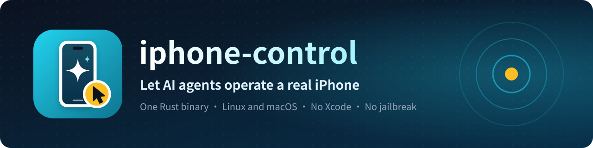
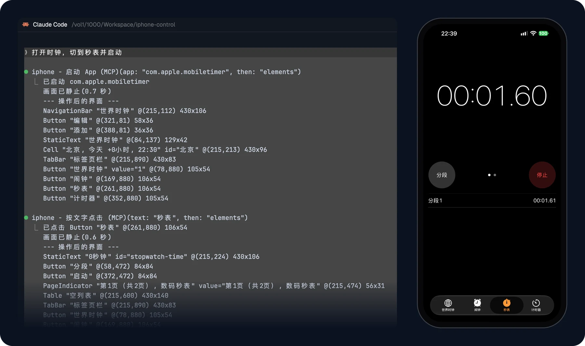
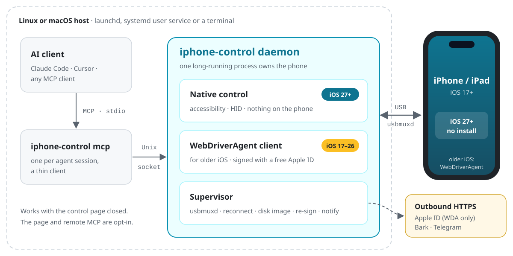
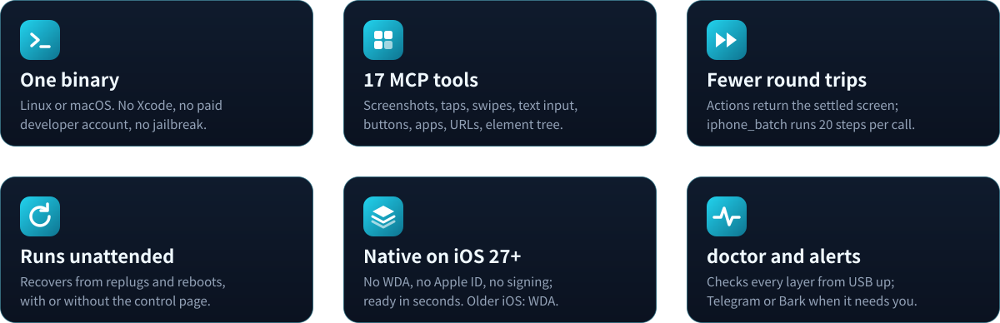

<div align="center">
  <a href="https://github.com/Derrors/iphone-control">
    
  </a>

  <p align="center">
    Let an AI agent operate a real iPhone or iPad plugged into a Linux machine or a Mac, reliably and fast — one Rust binary, no Xcode, no paid developer account, no jailbreak, and from iOS 27 no Apple ID either.
  </p>

  <p align="center">
    <a href="https://github.com/Derrors/iphone-control/releases/latest"></a>
    
    
    
    <a href="Cargo.toml"></a>
    <a href="LICENSE"></a>
    <a href="https://m8ven.ai/mcp/derrors-iphone-control-1pcmse?s=readme"></a>
  </p>

  <p align="center">
    <a href="#quick-start"><strong>🚀 Quick Start</strong></a>
    &nbsp;·&nbsp;
    <a href="https://derrors.github.io/iphone-control/en/"><strong>📖 Docs</strong></a>
    &nbsp;·&nbsp;
    <a href="https://github.com/Derrors/iphone-control/releases">📦 Releases</a>
    &nbsp;·&nbsp;
    <a href="https://github.com/Derrors/iphone-control/issues">🐛 Issues</a>
    &nbsp;·&nbsp;
    <a href="README.zh-CN.md">🌐 简体中文</a>
  </p>

  <br>
  
  <p><sub>Asking Claude Code to “open Clock, switch to the stopwatch and start it”. Left: Claude Code’s tool calls (first part only). Right: the phone afterwards.</sub></p>
</div>

## Overview

AI agents can drive browsers and desktops, but a real iPhone is harder: Apple's automation tools need a Mac and Xcode, and the open-source alternatives come as separate pieces that each need their own setup, signing and babysitting.

iphone-control does it all in **one Rust binary** on Linux or macOS, built on [idevice](https://github.com/jkcoxson/idevice), [Impactor](https://github.com/claration/impactor) and [WebDriverAgent](https://github.com/appium/WebDriverAgent). It succeeds [iphone-control-toolkit](https://github.com/Derrors/iphone-control-toolkit) and keeps its MCP tools compatible.

It has three layers, and device control is the core:

| Layer | What it does | Needs the control page? |
| --- | --- | --- |
| **Device control** (core) | A long-running daemon owns the phone and serves the MCP tools; recovers from unplugging and reboots; pausing, taking over and confirming AI tasks | No |
| **Access** | AI clients on this machine connect over stdio; other machines over HTTP MCP (`/mcp`) or `mcp --url` | Locally no; remotely the viewer service must run |
| **Control page** (optional) | Watch the live screen in a browser, act on it, hand out AI tasks | It is the control page |

Device control has two routes, picked by iOS version:

- **iOS 27 and later: native control (default).** The screen is read through the system's accessibility service, taps, swipes and buttons go through HID, and apps launch through CoreDevice. Nothing is installed on the phone: no Apple ID, no signing, ready in seconds.
- **iOS 17–26: WebDriverAgent.** Signed with a free Apple ID, installed on the phone and re-signed before the 7-day profile expires. This route stays maintained.

> [!TIP]
> **Use a device on iOS 27 or later if you can**, or update the phone to iOS 27: no Apple ID sign-in, no signing, no "Enable UI Automation" passcode after a reboot, and none of the expiring profiles, revoked certificates or stuck WebDriverAgent that come with it.

<p align="center">
  <picture>
    <source media="(prefers-color-scheme: dark)" srcset="website/public/architecture-dark.svg">
    
  </picture>
</p>

## Features

<p align="center">
  
</p>

**Device control (core)**

- **See and touch the screen**: screenshots with region zoom, tap, swipe, long-press, text input (including Chinese), hardware buttons
- **Work with UI elements**: read the element tree, tap by text (on a part not covered by floating bars or the keyboard), launch and close apps, open URLs, wait for text to appear
- **Fewer round trips**: any action can return the resulting screen once it has settled, say whether it changed, and flag pages still loading and blocking alerts; `iphone_batch` runs up to 20 steps in one call
- **Runs unattended**: recovers from replugging, phone reboots and lost connections, and keeps serving with the control page closed; a stuck WebDriverAgent is restarted and re-signed before it expires
- **A person stays in charge**: AI tasks can be paused, taken over or stopped at any time; paying, deleting or sending waits for your OK, and an agent can't approve its own task
- **Several devices**: connect several iPhones and iPads and switch which one is controlled
- **Optional auto-unlock**: every passcode digit is verified, and a wrong passcode disables auto-unlock after one attempt
- **Alerts**: Telegram or Bark notifications when the phone goes offline, a passcode is needed after a reboot, or re-signing fails
- **Diagnostics**: `doctor` checks every layer from USB up and tells you how to fix each failure

**Access**

- **On this machine**: Claude Code, Codex or any MCP client over stdio; `task run` runs any agent platform in a task whose every step you can follow
- **Remotely**: the viewer service serves HTTP MCP (`/mcp`) on its port, over HTTPS with a login token (read-only ones too) when opened to the network; `mcp --url` and `task --url` use a phone on another machine

**Control page (optional)**

- **Live screen**: on iOS 27 and later the phone's own video (about 60 fps), otherwise H.264; a low-bandwidth mode
- **Act on it**: the mouse taps and drags like a finger; system alerts missing from the video are drawn on it and can be tapped
- **Hand out tasks**: give a task to a local Claude Code or Codex, watch it work and take over at any time

## Quick Start

You need an iPhone or iPad (iOS 27+ recommended, iOS 17+ supported) connected by a **data** cable, and an Apple Silicon Mac or a Linux machine. On iOS 26 and earlier you also need a free Apple ID (use a dedicated one) to sign WebDriverAgent.

**macOS or Linux, one command** (upstream example; for a fork, use the installer asset from its own signed release)

```bash
curl -fsSLo iphone-control-install.sh https://github.com/Derrors/iphone-control/releases/latest/download/install.sh && sh iphone-control-install.sh
```

It downloads the release for your machine, verifies the Ed25519 release manifest and archive SHA-256 (Python 3 and OpenSSL 3 required), installs `iphone-control` into `~/.local/bin` and runs the daemon as a per-user service that starts at login (launchd on macOS, systemd on Linux). Run it as your regular user. Use `iphone-control update` to upgrade this managed service. Running `sh iphone-control-install.sh --uninstall` removes it and keeps your data.

Upstream v0.2.0 predates the signed installer. To install that release or migrate an existing script installation, follow the [v0.2.0 instructions](https://derrors.github.io/iphone-control/en/guide/getting-started#legacy-script).

**Or with a package manager**

```bash
# macOS or Linux (Homebrew)
brew install derrors/tap/iphone-control && brew services start iphone-control

# Debian 12+ / Ubuntu 22.04+: the .deb from Releases (amd64 or arm64), pulls in usbmuxd
sudo apt install ./iphone-control_<version>_amd64.deb && systemctl --user enable --now iphone-control
```

On Linux the system usbmuxd is needed (`sudo apt install usbmuxd`; the .deb brings it). On an Intel Mac, build from source.

**Then, on every system**

Connect the phone with the cable and run:

```bash
iphone-control
```

The first time, it walks you through setup in the terminal, one step at a time: language, proxy, the background service, pairing, Developer Mode (and on iOS 26 and earlier, Apple ID and signing and installing WebDriverAgent), the optional auto-unlock and notifications, and registering with Claude Code and Codex. Do what it asks on the phone. Steps already done are skipped; afterwards, `iphone-control` just shows the status.

Then open a new Claude Code or Codex session and ask, for example, *“Open Clock, switch to the stopwatch and start it.”* That is device control, complete; the control page is optional. To watch the phone in a browser, run `iphone-control viewer` for the control page in the browser (http://127.0.0.1:8200; log in with the link `iphone-control viewer token` prints), where you can act on the live screen and hand tasks to a local Claude Code or Codex; it works from the local network and other machines too, see [Viewer and Remote Use](https://derrors.github.io/iphone-control/en/guide/remote).

More: [step-by-step guide](https://derrors.github.io/iphone-control/en/guide/getting-started) · [build from source](https://derrors.github.io/iphone-control/en/deploy/source) · [macOS guide](https://derrors.github.io/iphone-control/en/deploy/macos) · [other MCP clients](https://derrors.github.io/iphone-control/en/guide/mcp-clients).

## MCP Tools

| Tool | Description |
| --- | --- |
| `iphone_status` | Connection, lock state, foreground app, screen size |
| `iphone_screenshot` | Screenshot scaled to points; pass `x/y/width/height` to zoom into a region |
| `iphone_list_elements` | Elements with text and their center coordinates; filter by text or type |
| `iphone_tap` / `iphone_tap_element` | Tap by coordinates or by element text |
| `iphone_swipe` / `iphone_long_press` | Swipe (returns once the list stops), long-press |
| `iphone_type_text` | Type into the focused field; reads it back and fixes dropped characters |
| `iphone_press_button` | `home`, `volume_up`, `volume_down`, `lock` |
| `iphone_list_apps` / `iphone_launch_app` / `iphone_terminate_app` | Manage apps by name or bundle ID |
| `iphone_open_url` | Open a URL or URL scheme |
| `iphone_wait_for` | Wait until some text appears instead of polling with screenshots |
| `iphone_batch` | Run up to 20 steps in one call, stopping at the first error |
| `iphone_list_devices` | Every iPhone/iPad on USB; marks the one being controlled |
| `iphone_select_device` | Switch to another device, or back to automatic choice |

`IPHONE_CONTROL_DEV_TOOLS=1` adds six opt-in [developer tools](docs/tools.md#developer-tools-opt-in): logs, crash reports, installing and removing apps, and two for Web Inspector (list web pages, run JavaScript in them). They are off by default; read the [security notes](SECURITY.md#developer-tools) before turning them on.

Action tools accept `then: "elements" | "screenshot"` to return the screen after the action. Screenshot pixels are tap coordinates, so the agent can tap what it sees. Games, maps and video players draw their own UI and have no element tree — use screenshots and coordinates there. Full parameters: [docs/tools.md](docs/tools.md).

Tool texts, results, CLI output and logs are in Simplified Chinese by default; set `IPHONE_CONTROL_LANG=en` for English ([configuration](https://derrors.github.io/iphone-control/en/guide/configuration)).

## Everyday Commands

| Command | What it does |
| --- | --- |
| *(none)* | The first time, the setup guide; after that, the status (and starts the service if it isn't running) |
| `setup [--reconfigure]` | Run the setup guide again; `--reconfigure` redoes one part (language, proxy, service, Apple ID, phone, auto-unlock, notifications, MCP registration) |
| `service install\|uninstall\|start\|stop\|restart\|status` | The background service (launchd on macOS, systemd user unit on Linux) |
| `daemon` | The long-running daemon; the service runs it, or start it by hand |
| `mcp [--url <viewer>]` | The MCP server; your AI client starts it. With `--url` it bridges to another machine's viewer |
| `status` | Daemon state, time left on the signing profile, recent log |
| `doctor` | Layer-by-layer health check with a fix for each failure |
| `login` | Sign in to the Apple ID again when the session expires (WebDriverAgent devices only) |
| `sign` | Sign and install WebDriverAgent now (likewise) |
| `resign [--force]` | Re-sign WebDriverAgent if it expires soon (or now) (likewise) |
| `passcode set\|clear` | Turn auto-unlock on or off for a device (passcodes are kept per device) |
| `unlock-reset` | Turn auto-unlock back on after it was disabled |
| `devices` / `select <UDID\|name\|auto>` | List connected devices / switch which one is controlled |
| `notify-test [event]` | Send test notifications |
| `mcp-config` | Print the command that registers the MCP server |
| `wda-bridge [--port]` | Expose WebDriverAgent on 127.0.0.1 for other tools; stop it when done (WebDriverAgent devices only) |
| `viewer [--port] [--lan]` | Control page on 127.0.0.1:8200, behind a login (`viewer token` shows the token and a link; read-only tokens too): live screen you can tap, swipe and type on, device panel, and AI tasks run by a local Claude Code or Codex. `--lan` opens it to the local network (HTTPS), and MCP over HTTP is on the same port (`/mcp`) |
| `task run [--url <viewer>] -- <command>` | AI tasks for other agent platforms; with `--url` the phone is on another machine. `task list`, `pause`, `approve`… follow and control tasks |
| `viewer token [add <name> [--read-only]\|list\|show <name>\|remove <name>]` | The viewer's login tokens: show the owner's, or add named and read-only ones |
| `service viewer install\|uninstall\|start\|stop\|restart` | Run the viewer as a background service of its own |
| `update check\|apply\|policy` | Check for, install, or set the policy for updates |
| `completions <shell>` | Bash, Zsh or Fish completion script |

All commands and options: [CLI reference](https://derrors.github.io/iphone-control/en/guide/cli).

Run `iphone-control update` to check for a stable release. When an upgrade is available, it uses the signed update for a managed service, Homebrew for a tap installation, or apt for a Debian package. It reports when you're up to date. Source installations follow the [source upgrade instructions](https://derrors.github.io/iphone-control/en/deploy/source#upgrade).

To check versions, open **About & updates** in Viewer or run `iphone-control update check --json`. Managed services can opt in to signed patches while idle with `iphone-control update policy auto-patch`. Use `iphone-control update policy notify` to return to checks only. Read the [upgrade notes](CHANGELOG.md) before upgrading.

Uninstall with `sh iphone-control-install.sh --uninstall`, `brew uninstall iphone-control` or `sudo apt remove iphone-control`; your data stays. Settings live in `~/.config/iphone-control/env`: the guide writes it, and after editing it by hand run `iphone-control service restart` — see [configuration](https://derrors.github.io/iphone-control/en/guide/configuration). All state lives in `~/.local/share/iphone-control`: the Apple ID session and signing key, and the passcode if auto-unlock is on. **Back it up; never commit or share it.**

## Documentation

| | |
| --- | --- |
| Guide | [What is it](https://derrors.github.io/iphone-control/en/guide/what-is-iphone-control) · [Limitations](https://derrors.github.io/iphone-control/en/guide/what-is-iphone-control#limitations) · [Getting started](https://derrors.github.io/iphone-control/en/guide/getting-started) · [AI clients](https://derrors.github.io/iphone-control/en/guide/mcp-clients) · [Tools](https://derrors.github.io/iphone-control/en/guide/tools) |
| Usage | [Configuration](https://derrors.github.io/iphone-control/en/guide/configuration) · [CLI](https://derrors.github.io/iphone-control/en/guide/cli) · [Several devices](https://derrors.github.io/iphone-control/en/guide/multi-device) · [Notifications](https://derrors.github.io/iphone-control/en/guide/notifications) · [Auto-unlock](https://derrors.github.io/iphone-control/en/guide/auto-unlock) |
| Deployment | [Install](https://derrors.github.io/iphone-control/en/guide/getting-started#install) · [Build from source](https://derrors.github.io/iphone-control/en/deploy/source) · [macOS](https://derrors.github.io/iphone-control/en/deploy/macos) · [Data and backups](https://derrors.github.io/iphone-control/en/deploy/backup) |
| Problems | [FAQ](https://derrors.github.io/iphone-control/en/troubleshoot/faq) · [Troubleshooting](docs/troubleshooting.md) · [Issues](https://github.com/Derrors/iphone-control/issues) |
| Security | [SECURITY.md](SECURITY.md): what is stored, who can reach it, reporting vulnerabilities |
| Development | [Contributing](CONTRIBUTING.md) · [Architecture](docs/architecture.md) · [Decisions](docs/decisions.md) · [Changelog](CHANGELOG.md) |
| Licensing | [THIRD_PARTY.md](THIRD_PARTY.md): vendored components, versions and licenses |

The architecture and design documents are in Chinese for now.

> [!WARNING]
> This tool can fully control your phone. An agent may tap payment, delete or send buttons — keep tool-call confirmation on in your MCP client. Not affiliated with Apple; use it only with devices and accounts you own. Read [SECURITY.md](SECURITY.md) before enabling auto-unlock.

## Contributing

Issues and pull requests are welcome — see the [contributing guide](CONTRIBUTING.md).

## License

[MIT](LICENSE). Third-party components: [THIRD_PARTY.md](THIRD_PARTY.md).
