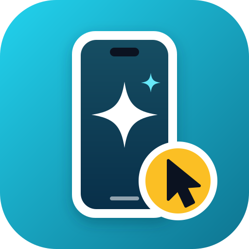
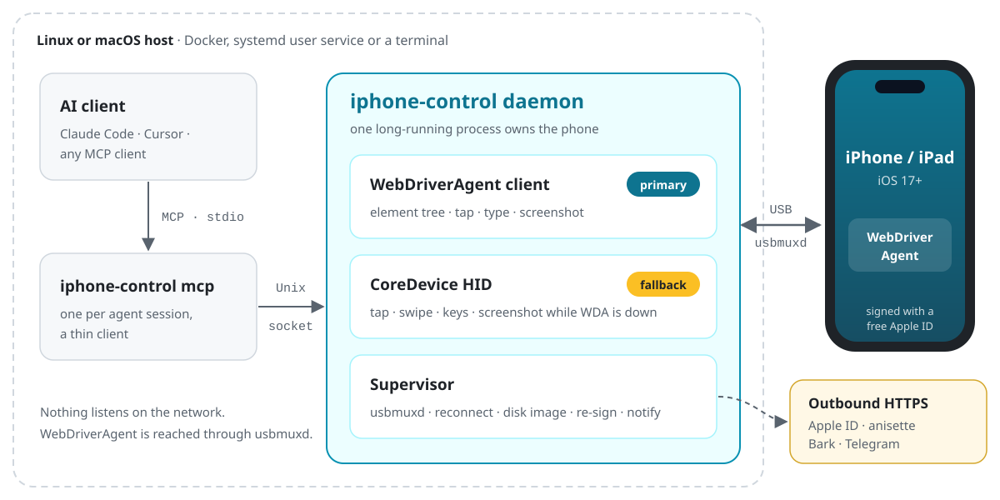

<a name="readme-top"></a>

<div align="right">
  <a href="README.md">English</a> | <b>简体中文</b>
</div>

<div align="center">
  <a href="https://github.com/Derrors/iphone-control">
    
  </a>

  <h3 align="center">iphone-control</h3>

  <p align="center">
    让 AI agent 操作一台接在 Linux 上的真实 iPhone：一个 Rust 二进制，不需要 Mac，不需要付费开发者账号，不越狱。
  </p>

  <p align="center">
    <a href="https://github.com/Derrors/iphone-control/releases/latest"></a>
    <a href="https://github.com/Derrors/iphone-control/pkgs/container/iphone-control"></a>
    
    
    <a href="Cargo.toml"></a>
    <a href="https://github.com/Derrors/iphone-control/actions/workflows/ci.yml"></a>
    <a href="LICENSE"></a>
  </p>

  <p align="center">
    <a href="#快速开始"><strong>🚀 快速开始</strong></a>
    &nbsp;·&nbsp;
    <a href="https://derrors.github.io/iphone-control/"><strong>📖 文档</strong></a>
    &nbsp;·&nbsp;
    <a href="https://github.com/Derrors/iphone-control/releases">📦 版本发布</a>
    &nbsp;·&nbsp;
    <a href="https://github.com/Derrors/iphone-control/issues">🐛 问题反馈</a>
  </p>
</div>

> [!NOTE]
> 早期版本（0.x），在 **iPhone 15 Pro Max（iOS 27.0.1）** 上完整测试过。其他机型和 iOS 17 以上应该也能用，但还没测过，欢迎反馈。

## 简介

AI agent 已经能操作浏览器和电脑桌面，但真实的 iPhone 难得多：苹果的自动化工具需要 Mac 和 Xcode，开源替代品又是零散的几块，每一块都要单独安装、签名、看护。

iphone-control 在 Linux 上用**一个 Rust 二进制**把这些事都做了，基于 [idevice](https://github.com/jkcoxson/idevice)、[Impactor](https://github.com/claration/impactor) 和 [WebDriverAgent](https://github.com/appium/WebDriverAgent)。一个常驻守护进程独占手机（隧道、HID 会话、WebDriverAgent 会话常驻复用），把它交给 Claude Code 或任何 MCP 客户端。它是 [iphone-control-toolkit](https://github.com/Derrors/iphone-control-toolkit) 的继任者，MCP 工具保持兼容。

<p align="center">
  <picture>
    <source media="(prefers-color-scheme: dark)" srcset="website/public/architecture-dark.svg">
    
  </picture>
</p>

## 功能特性

- **看屏幕、点屏幕**：截图（可放大某块区域）、点击、滑动、长按、输入文字（支持中文）、硬件按键
- **按界面元素操作**：读元素树、按文字点击（自动避开悬浮栏、键盘挡住的部分）、启动和结束 App、打开链接、等某段文字出现
- **省往返**：任何操作都可以等界面稳定后顺带返回操作后的样子，并提示页面是否还在加载、有没有弹窗挡着；`iphone_batch` 一次执行最多 20 步
- **自动后备**：WebDriverAgent 不可用时，截图、点击、滑动、按键改走苹果的 CoreDevice HID 服务
- **无人值守**：拔插、手机重启、WebDriverAgent 崩溃后自动恢复；用免费 Apple ID 签名，7 天描述文件过期前自动重签
- **告警通知**：重签失败、Apple ID 会话失效、手机离线、重启后需要输密码时，经 Telegram 或 Bark 推送
- **可选的自动解锁**：每输一位都核对，密码错了只试一次就停用
- **诊断**：`doctor` 从 USB 到 WebDriverAgent 逐层检查，每项失败都告诉你怎么修

## 快速开始

需要一台装了 Docker（Compose v2）的 Linux 主机（x86_64 或 arm64）、一部 iOS 17 以上的 iPhone 和能**传数据**的线，以及一个免费 Apple ID（建议专门注册一个，不要用主账号）。

```bash
git clone https://github.com/Derrors/iphone-control.git
cd iphone-control
cp .env.example .env                                  # 可选：代理、通知；国内网络一般要配代理
docker compose up -d --build                          # 首次构建要编译 Rust，需要几分钟
docker exec -it iphone-control iphone-control setup   # 安装向导，可重复运行
claude mcp add iphone -s user -- docker exec -i iphone-control iphone-control mcp
```

`setup` 会引导完成配对、打开开发者模式、登录 Apple ID、签名并安装 WebDriverAgent。手机上要做的是点「信任」、打开开发者模式，以及在 设置 → 通用 → VPN 与设备管理 里信任你的 Apple ID，详见[分步指南](https://derrors.github.io/iphone-control/guide/getting-started)。

打开一个新的 Claude Code 会话，试着说：

> 打开时钟，切到秒表，给我看一下截图。

> [!TIP]
> 其他 MCP 客户端：服务经 `docker exec` 走 stdio，不开任何网络端口。
>
> ```json
> { "mcpServers": { "iphone": { "command": "docker", "args": ["exec", "-i", "iphone-control", "iphone-control", "mcp"] } } }
> ```

发布正式版本后可以不自己构建：在 `.env` 里设 `IMAGE=ghcr.io/derrors/iphone-control:latest`，然后 `docker compose pull && docker compose up -d --no-build`。不用 Docker 的话，可以用[预编译二进制或从源码编译](https://derrors.github.io/iphone-control/deploy/source)，以 systemd 用户服务运行。

## MCP 工具

| 工具 | 作用 |
| --- | --- |
| `iphone_status` | 连接状态、是否锁屏、前台 App、屏幕尺寸 |
| `iphone_screenshot` | 截图（单位为点）；给出 `x/y/width/height` 时放大这块区域 |
| `iphone_list_elements` | 带文字的元素和中心点坐标；可按文字或类型筛选 |
| `iphone_tap` / `iphone_tap_element` | 按坐标或按元素文字点击 |
| `iphone_swipe` / `iphone_long_press` | 滑动（列表停稳后返回）、长按 |
| `iphone_type_text` | 在当前输入框输入文字；输完读回核对，丢字会补上 |
| `iphone_press_button` | `home`、`volume_up`、`volume_down`、`lock` |
| `iphone_list_apps` / `iphone_launch_app` / `iphone_terminate_app` | 按名字或 Bundle ID 管理 App |
| `iphone_open_url` | 打开链接或 URL Scheme |
| `iphone_wait_for` | 等某段文字出现，代替反复截图 |
| `iphone_batch` | 一次执行最多 20 步，出错就停 |

操作类工具可以带 `then: "elements" | "screenshot"`，顺带返回操作后的界面。截图的像素就是点击坐标，agent 看到哪里就能点哪里。游戏、地图、视频自己绘制界面，没有元素树，只能看截图按坐标操作。完整参数见 [docs/tools.md](docs/tools.md)。

## 常用命令

用 `docker exec -it iphone-control iphone-control <命令>` 运行；从源码运行时直接调用。

| 命令 | 作用 |
| --- | --- |
| `status` | 守护进程状态、描述文件还剩多久、最近日志 |
| `doctor` | 逐层诊断，每项失败都给出修复办法 |
| `setup` | 安装向导，随时可以重新运行 |
| `login` | Apple ID 会话失效时重新登录 |
| `resign [--force]` | 快过期才重签 WebDriverAgent（或立即重签） |
| `passcode set\|clear` | 开启或关闭自动解锁 |
| `notify-test [事件]` | 发送测试通知 |
| `mcp-config` | 打印注册 MCP 的命令 |

升级：`git pull && docker compose up -d --build`（用预构建镜像时改为 `docker compose pull`）。配置写在 `.env`，见[配置说明](https://derrors.github.io/iphone-control/guide/configuration)。所有状态都在 `data/`：配对记录、Apple ID 会话和签名私钥，开启自动解锁时还有锁屏密码。**要备份，不要提交或分享。**

## 文档

| | |
| --- | --- |
| 入门 | [什么是 iphone-control](https://derrors.github.io/iphone-control/guide/what-is-iphone-control) · [快速开始](https://derrors.github.io/iphone-control/guide/getting-started) · [接入 AI 客户端](https://derrors.github.io/iphone-control/guide/mcp-clients) · [工具一览](https://derrors.github.io/iphone-control/guide/tools) |
| 使用 | [配置](https://derrors.github.io/iphone-control/guide/configuration) · [通知](https://derrors.github.io/iphone-control/guide/notifications) · [自动解锁](https://derrors.github.io/iphone-control/guide/auto-unlock) |
| 安装 | [Docker](https://derrors.github.io/iphone-control/deploy/docker) · [从源码 / 二进制](https://derrors.github.io/iphone-control/deploy/source) · [数据与备份](https://derrors.github.io/iphone-control/deploy/backup) |
| 问题 | [常见问题](https://derrors.github.io/iphone-control/troubleshoot/faq) · [排错（英文）](docs/troubleshooting.md) · [Issues](https://github.com/Derrors/iphone-control/issues) |
| 安全 | [SECURITY.md](SECURITY.md)：存了什么、谁能访问、怎么报告漏洞 |
| 开发 | [贡献指南](CONTRIBUTING.md) · [架构](docs/architecture.md) · [关键取舍](docs/decisions.md) · [更新日志](CHANGELOG.zh-CN.md) |
| 许可证 | [THIRD_PARTY.md](THIRD_PARTY.md)：vendor 组件、版本和许可证 |

## 限制

- 一台主机接一部手机；不要同时运行两份（或其他基于 usbmuxd 的工具）连同一部手机
- 免费 Apple ID 的描述文件 7 天有效。重签是自动的，但 Apple ID 会话失效后要运行 `login`
- 手机重启后，要人工解锁一次，并输一次密码允许 UI 自动化，这是 iOS 的要求
- 登录 Apple ID 默认用公共的第三方 anisette 服务；可设 `ICTL_ANISETTE_URL` 换成自建服务
- 容器以 root 运行：要访问 USB 设备节点，拔插后还要能重启 usbmuxd

> [!WARNING]
> 这个工具能完全控制你的手机，agent 可能点到付款、删除、发送这类按钮，请在 MCP 客户端里保持工具调用确认。本项目与 Apple 无关；只在你自己的设备和账号上使用。开启自动解锁前请先读 [SECURITY.md](SECURITY.md)。

## 参与贡献

欢迎通过 [Issues](https://github.com/Derrors/iphone-control/issues) 反馈问题、提交 Pull Request，详见[贡献指南](CONTRIBUTING.md)。

## License

[MIT](LICENSE)，第三方组件见 [THIRD_PARTY.md](THIRD_PARTY.md)。

<p align="right">(<a href="#readme-top">回到顶部</a>)</p>
