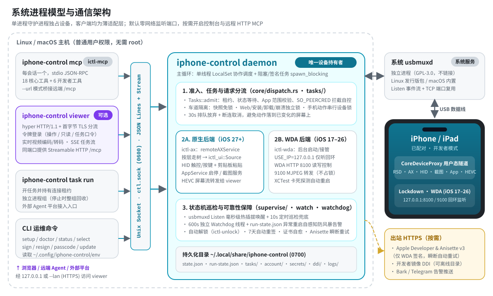
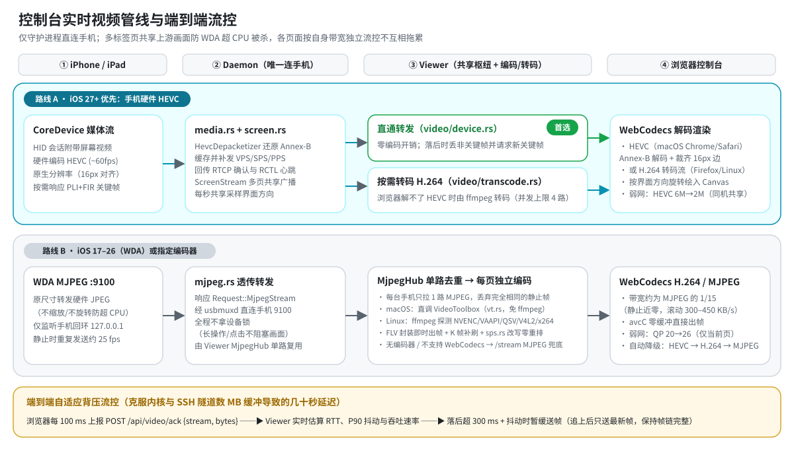
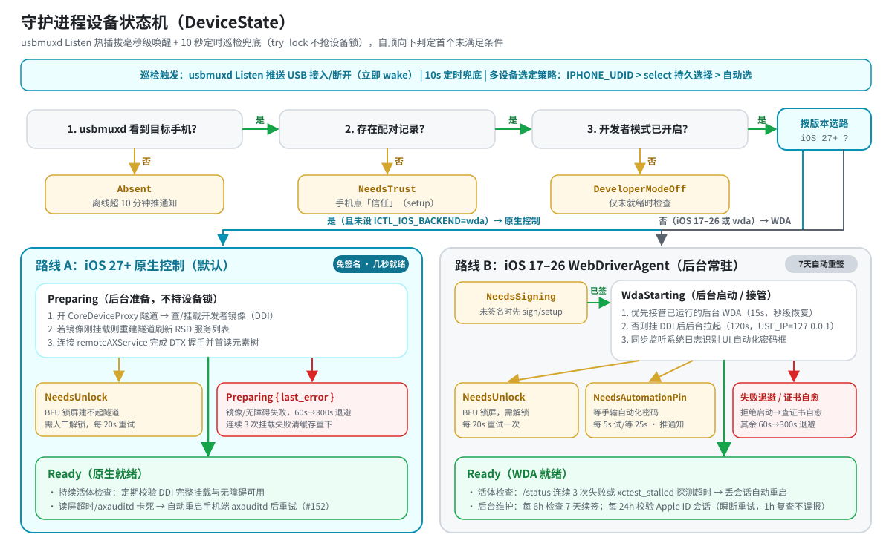
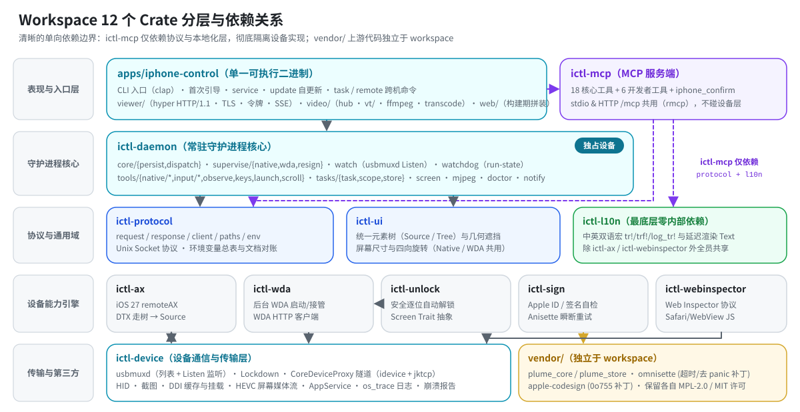

# 架构

## 1. 总览

  <picture>
    <source media="(prefers-color-scheme: dark)" srcset="images/arch-system-dark.svg">
    
  </picture>

和早期脚本工具集（`iphone-control-toolkit`）的根本区别：toolkit 每条 HID 命令都要重新建一次隧道（3～5 秒），WDA 端口转发需要单独进程，各工具各建各的隧道。本项目采用**守护进程独占设备**架构：隧道、HID 会话（含显示媒体流）、无障碍会话与 WDA 会话均由守护进程常驻复用；MCP 与命令行只是薄客户端。

## 2. 进程模型

| 进程 | 生命周期 | 职责 |
|---|---|---|
| `iphone-control daemon` | 常驻，作为用户服务运行（macOS 为 launchd，Linux 为 systemd 用户服务；由 `install.sh`、`service install`、`brew services` 或 `.deb` 装好），也可前台运行 | 唯一与设备通信的进程。维护设备状态机，独占隧道与设备会话，提供本地控制接口 |
| `iphone-control mcp` | 每个 agent 会话一个 | MCP stdio 服务，将工具调用转为守护进程请求；`--url` 时转为把 stdio 桥接到另一台机器控制台的 `/mcp`（`mcp_bridge.rs`） |
| `iphone-control viewer` | 显式开启，可装为独立后台服务（`service viewer install`） | 基于 `hyper` HTTP/1.1 的控制台网页与同端口 HTTP MCP（`/mcp`）；强制令牌登录，`--lan` 时按首字节分流 HTTPS；负责实时画面编码/转码与内建 AI 任务编排 |
| `iphone-control task run` | 每个外部 AI 任务一个 | 开任务、以连接持有租约、在独立进程组里运行命令（`task.rs`、`procgroup.rs`）；`--url` 时经远端控制台执行（`remote.rs`） |
| `usbmuxd` | 系统服务（Linux 发行版包由 udev 拉起，macOS 内置）；守护进程不启停它 | GPL-3.0 独立进程，不链接；提供 USB 设备列表、`Listen` 热插拔事件流与端口复用 |
| `iphone-control`（无子命令）、`setup`、`service`、`doctor`、`sign` 等 | 一次性 | 首次运行引导（`guide.rs`）、服务管理与运维命令。除 `completions` 外启动时自动加载 `~/.config/iphone-control/env`（已有环境变量优先） |

### 多实例

一台设备一个守护进程（[D19](decisions.md#d19一台主机同时控制多台设备每台设备一个守护进程多实例2026-11-29)、[multi-instance-plan.md](dev/multi-instance-plan.md)）。命令行、服务、MCP 在读设置之前按 `--instance`/`IPHONE_CONTROL_INSTANCE` 找到实例（`ictl-daemon/src/instance.rs` 的 `resolve`），命名实例的 socket、数据目录、设备、端口、ID 只取自登记。共用的东西在数据根（默认实例的数据目录）：账号目录（账号锁、凭据代次，`ictl-sign/src/account.rs`）、密码和停用记录、设备租约（`lease.rs`）、后台 WDA 的接管记录（`adopt.rs`）、控制台令牌和证书包。设备的租约由巡检拿（`claim.rs`）；不持设备锁做事的拿准入凭据（`admission.rs`），`select` 换台按 `switch.rs` 的 8 步走；每日会话检查由领导实例做（`supervise/session.rs`）；有命名实例时升级经 `update/fleet.rs` 一起处理所有实例。

### 本地控制接口与网络边界

控制接口使用权限 `0600` 的 Unix socket（普通用户默认 `$XDG_RUNTIME_DIR/iphone-control/ctl.sock`，macOS 等无该变量时在数据目录下；root 为 `/run/iphone-control/ctl.sock`），采用 JSON 行协议（流式画面与任务事件在同一连接上转为二进制帧或行流）。请求/响应类型与客户端在 `ictl-protocol`，供 MCP、CLI 与控制台共用：

- **默认零监听端口**：不对外开放 TCP 端口。WDA 经 `idevice` provider 直连手机端口，且启动时强制带 `USE_IP=127.0.0.1`（`ictl_wda::runner::WDA_BIND_IP`），8100/9100 仅监听手机回环地址，防止手机连 Wi-Fi 时被局域网直接访问。
- **可选端口均显式开启并加固**：
  - `wda-bridge`：显式开启，仅绑 `127.0.0.1`，校验回环 `Host` 防 DNS rebinding（无认证，本机任意用户可连，用完即停）。
  - `viewer`：默认仅绑 `127.0.0.1`，所有 HTTP 访问（含本机，防反向代理伪装本地）均须登录令牌；校验 `Host`、`Origin`、JSON `Content-Type` 与 `Sec-Fetch-Site`，且动作附带页面所跟设备的 UDID；`--lan` 仅放行回环与私网/链路本地/Tailscale（`100.64/10`）来源并启用 HTTPS（详情见 [task-control.md](task-control.md#7-远程控制面与局域网访问) 与 [D3](decisions.md#d3wda-不在本机监听端口)）。

### 实时画面管线与流控

除 `wda-bridge` 外，只有守护进程直接连接手机；控制台的实时画面统一由守护进程转发，按设备系统与浏览器解码能力自动选路与回退：

  <picture>
    <source media="(prefers-color-scheme: dark)" srcset="images/arch-video-pipeline-dark.svg">
    
  </picture>

| 路线 | 适用场景 | 传输与编码细节 | 流控与弱网模式 |
|---|---|---|---|
| **手机硬件 HEVC 直通**（`/video?src=device`） | iOS 27+ 且浏览器支持 WebCodecs HEVC（macOS Chrome / Safari） | `ictl-device/media.rs` 用 `HevcDepacketizer` 还原 Annex-B、补全参数集（VPS/SPS/PPS）并回传 RTCP（帧确认 / 50ms RCTL / 1s RR / 按需 PLI+FIR）；`screen.rs` 通过 `ScreenStream` 广播给多页并共享每秒一次方向采样；页面裁掉 16px 对齐边并按方向转正 | 落后时丢非关键帧并请求新关键帧；弱网模式与手机重协商上限（6 → 2 Mbit/s，同机共享） |
| **手机 HEVC → H.264 转码**（`/video`） | iOS 27+ 但浏览器不支持 HEVC（Firefox / 多数 Linux Chrome） | `video/transcode.rs` 为每页起一个 ffmpeg 将 HEVC 转为 H.264，同时上限 4 路（超限回 503，页面自动重试） | 落后时暂停送帧，追上后请求关键帧重新对齐；弱网模式单页提高 QP 至 26 |
| **WDA MJPEG → 本机 H.264**（`/video`） | iOS 17–26，或显式指定 WDA / H.264 编码器 | 守护进程 `mjpeg.rs` 不持设备锁透传 WDA 9100；`video/hub.rs` 每机单路共享并丢弃静止重复帧（防 WDA 多路截图超 80% CPU 被 iOS 杀掉）。macOS 直调原生 VideoToolbox（`video/vt.rs`，硬件解 JPEG→NV12→avcC，免 ffmpeg）；Linux 经 ffmpeg 按序探测 NVENC → VAAPI → QSV → V4L2 → x264（FLV 即时出帧 + 探测期测出 K 帧补刷 + `sps.rs` 改写零重排避免 Chrome 扣帧） | 浏览器每 100ms 发 `POST /api/video/ack` 上报已读字节；落后超 `RTT + 300ms + P90抖动` 或在途超带宽预算时停送新帧、追上只送最新帧（保帧链完整免重发关键帧）；弱网单页 QP 20 → 26 |
| **MJPEG 兜底**（`/stream`） | Linux 未装 ffmpeg、无可用编码器或旧浏览器不支持 WebCodecs | 复用 `MjpegHub` 去掉静止重复帧，只发最新一帧，帧尾补下一段分隔符与头（满足 Chrome 即时显示） | 链路慢时自动跳帧只发最新图 |

自动回退顺序：**手机 HEVC → 本机编码 H.264 → MJPEG**（服务端 404 或 `isConfigSupported` 为假则不再试该路；出画面前断开按 30 / 60 / 120 秒退避重试，出画面后重置计数）。

### AI 任务执行模型

任务由守护进程集中管理（`tasks/`，完整设计见 [task-control.md](task-control.md)、[D17](decisions.md#d17任务和租约放进守护进程2026-11-12)）：

- **租约与准入**：`task_open` 的连接即租约，断连立即转 `abandoned`；`Daemon::handle` 在排队拿锁前先过 `Tasks::admit`，拿锁后再由 `Tasks::still` 二次核对。任务绑定创建时的设备 UDID；非 `Running` 时任务动作挂起等待，其余客户端只读（人接管期间可操作，交还后要求 Agent 重新观察）；限定 App（`apps`）越界时与 `iphone_confirm` 复用同一套人工确认机制。
- **内建 Runner 与落盘**：控制台 `agent.rs` 在独立进程组中拉起本地 Claude Code（`--tools ""`、`--strict-mcp-config`）或 Codex（只读沙箱，`default_tools_approval_mode="approve"`，由 `iphone_confirm` 把关）并注入 `IPHONE_CONTROL_TASK_TOKEN`。事件追加落盘到 `tasks/<id>.jsonl`（最多 50 个任务，单任务上限 16,384 条或 16 MiB，满额后仍保底写首条 `task` 与终态 `done`）；重放采用「持锁拍快照 + 放锁 `spawn_blocking` 读精确前缀」，不阻塞主循环。

### 并发模型与锁隔离

主循环全部运行在单线程 `tokio::task::LocalSet` 中（详见 `crates/ictl-daemon/src/core.rs` 顶注；`plume_core` 签名等阻塞操作已放进 `spawn_blocking`）。2026-11 评估过迁移多线程 runtime，但 rustc 对跨 `await` 泛型高阶生命周期的 `Send` 推断存在局限，会连带波及 `ictl-ax` / `ictl-device`，且实测单线程并未拖慢实时视频转发，因此保持单线程 `LocalSet` 并通过精细车道隔离保证低延迟：

| 请求 / 任务类型（`core/dispatch.rs`） | 锁策略 | 保护与兜底机制 |
|---|---|---|
| `status`、`devices` 快照读取 | **无锁**（读取 `watch` 通道快照） | 长操作期间秒级响应 |
| 屏幕视频流（`ScreenStream` / `MjpegStream`）、任务事件流 | **不持设备锁** | 画面转发与事件回放不受慢操作阻塞 |
| `iphone_web_targets`、`iphone_web_eval` | **独立 Web Inspector 锁** | 慢网页 JS 不挡点击与截图 |
| `iphone_install_app`、卸载、崩溃报告（`Lane::Apart`） | **不持设备锁**（安装间在 `Device::install` 互斥） | 耗时的 lockdown/AFC 传输不挡界面读写 |
| `doctor`（`Lane::Doctor`） | **先无锁查本机，再持设备锁查手机** | usbmuxd / Apple ID / ffmpeg 检查不占设备锁 |
| WDA 启动/原生准备、7 天重签、Apple ID 会话检查 | **后台异步 / 三段式**（持锁取参 → 无锁耗时 → 持锁回写） | 启动与重签期间 HID 后备与只读查询仍可用 |
| 10 秒定期巡检 | **`try_lock`** | 设备正忙直接跳过本轮，不排队抢锁 |
| 点击、滑动、输入、读树、截图等手机操作 | **串行设备锁** | 改变状态的请求排队超 30 秒直接放弃；调用方断连立即取消；停止信号 `biased` 优先回收 |
| 极端卡死兜底（`watchdog.rs`） | **独立 OS 线程（每 30 秒巡检）** | 约 600 秒无任何巡检或请求完成则主动退出交由服务管理器重启，并经 `run-state.json` 在下次启动自感知推送告警 |

## 3. 守护进程状态机

状态定义在 `crates/ictl-daemon/src/machine.rs`（`DeviceState`），推进在 `supervise.rs`。同一时间只控制一台设备（[D11](decisions.md#d11接多台设备时同一时间只控制一台)），优先级为 `IPHONE_UDID` > `select` 持久化选择 > 自动选；选定的设备离线时停在 `Absent`，绝不静默切换。

  <picture>
    <source media="(prefers-color-scheme: dark)" srcset="images/arch-state-machine-dark.svg">
    
  </picture>

### 原生控制（iOS 27+）运行时细节

iOS 27 及以上默认走 `tools/native/`（详见 [ios27-native.md](dev/ios27-native.md)），不签名、不启动 WDA：

- **读界面**：每次向 `remoteAXService` 按层流水线走一遍前台 App 元素树（类型 4 取前台 → 按层批量并发类型 5 属性请求并按返回对象配对，上限 400 元素 / 4 秒），WebKit WebContent 元素原样保留屏幕坐标，再叠加读取 SpringBoard 弹窗层（上限 80 元素 / 2 秒），直接构造 `ictl_ui::Source`（零 XML 转换）交给 `ictl_ui::Tree::of`，与 WDA 共享查找、遮挡、弹窗与密码栏判定逻辑。手机仅在前台 App 切换时推送树，因此不依赖推送。
- **操作与稳定**：等稳定与 WDA 同样轮询（连续两次树一致且无加载指示器），操作后首次读取前等待 **0.3 秒**（`tools/native/ax.rs` 的 `REACT`）。触控/按键走 HID，输入一律走剪贴板粘贴并自动点「允许粘贴」后还原剪贴板；App 启停与 URL 走 CoreDevice AppService；锁屏状态问 lockdown（`PasswordProtected`，须先建会话）；自动解锁经 `ictl_unlock::Screen` 复用同一套规则，读锁屏前先关 HID 会话（媒体流开着时锁屏对无障碍是空的）。无障碍会话归 `Tunnel`，空闲 60 秒关闭；遇到手机端 `axauditd` 卡死自动重启该进程后重试（#152）。

### 关键恢复与防坑机制

以下每条均来自真实设备长期运行经验：

- **毫秒级热插拔与容错**：守护进程后台维护一条 `usbmuxd` `Listen` 长连接（`ictl-device/watch.rs` + `ictl-daemon/watch.rs`），收到 USB 接入/断开事件立即唤醒巡检（`Daemon::wake`），发现延迟从最多 10 秒降至毫秒级；用上限 1024 的有界集合滤除 Wi-Fi 等非 USB 噪音，断连按 1s → 30s 指数退避（稳定存活满 10 秒重置）静默重连，停机时立即取消并释放 socket。同时保留 10 秒定时巡检兜底；列设备连续 3 轮失败才判离线。`doctor` 另核对 sysfs（Linux）或 IORegistry（macOS）的 Apple USB 设备（`05ac`），区分「线没接好」与「usbmuxd 异常」。
- **用户态隧道（无 root）**：基于 CoreDeviceProxy + `jktcp` 用户态 TCP 栈，不创建 TUN 网卡。重启后首次解锁（BFU）前建隧道报 `PasswordProtected` → `NeedsUnlock`（每 20 秒重试）。WDA 掉线或 usbmuxd 重启时一并丢弃旧隧道，避免复用失效句柄白白退避。
- **HID 会话与残留清理**：HID 会话归 `Tunnel` 所有，空闲 30 秒关闭，重开约 0.5 秒。关闭时必须先停媒体流再断隧道，否则手机灵动岛常驻「正在被查看」且不自动锁屏。若上次守护进程异常退出遗留 `hid-open/<UDID>` 标记，新进程就绪后自动开关一次 HID 清理手机状态（`hidmark.rs`）。
- **开发者镜像（DDI）**：每次就绪前先 `installed_ddi()`（已挂载约 1 秒），未挂载再执行个性化 + TSS 挂载；iOS 17–18 经 lockdown `mobile_image_mounter` 挂经典个性化镜像（`ddi/personalized/`）。默认缓存连续 3 次**挂载**失败才清缓存重下（隧道失败不计入）；设了 `ICTL_DDI_DIR` 则不下载也不删除用户目录。
- **后台 WDA 接管与卡死恢复（[D18](decisions.md#d18守护进程总在后台启动-wda去掉-ictl_wda_detached2026-11-15)）**：守护进程总在后台启动 WDA（DVT processcontrol，`USE_IP=127.0.0.1`），不持有 XCTest 会话，并在 `state.json` 记录各设备的后台 WDA PID（`detached_wdas` / `loopback_wdas`）。守护进程重启或切换设备切回时优先 15 秒内接管原进程（秒级恢复）；`service stop` / `uninstall` 时主动结束它。运行时除检查 `/status`（连续 3 次失败算掉线）外，还会通过 `xctest_stalled` 探测 XCTest 卡死并自动重启。
- **UI 自动化密码框识别**：重启后首次启用 UI 自动化若弹出「为 XCTest 输入 iPhone 密码」，通过手机系统日志流（`os_trace_relay`）识别 `testmanagerd` 关键字进入 `NeedsAutomationPin` 并推送一次通知；之后每 5 秒重试一次（每次等 25 秒），恢复后推送 `WdaRecovered`。

## 4. 模块划分

  <picture>
    <source media="(prefers-color-scheme: dark)" srcset="images/arch-crate-deps-dark.svg">
    
  </picture>

| Crate | 职责 | 关键依赖 |
|---|---|---|
| `ictl-l10n` | 界面与日志双语基础层：`tr!` / `trf!` / `log_tr!` / `log_trf!` 宏，及同时保留中英双语、渲染时按读取方语言选择的 `Text`（`text!` / `textf!`，见 [D12](decisions.md#d12代码内嵌双语文字)） | `tokio`（仅 `rt`） |
| `ictl-ui` | 统一界面元素树（`Source` / `Tree`，原生与 WDA 共用）、按文本查找、遮挡检测、系统弹窗与密码栏判定；屏幕尺寸与四向旋转类型 | `ictl-l10n` |
| `ictl-protocol` | 控制接口 `Request`（`request.rs`）、`Response` / `Outcome` / `Data` / `ScreenMsg`（`response.rs`）、Unix socket 客户端与任务流（`client.rs`）、默认路径与权限判断（`paths.rs`）、环境变量总表与文档对账单测（`env.rs`） | `serde`、`serde_json`、`tokio`、`libc`、`ictl-l10n` |
| `ictl-ax` | iOS 27+ `remoteAXService` DTX 会话：握手、帧读取、按层流水线走树，直接输出 `ictl_ui::Source`（`node.rs`，零 XML） | `idevice`、`plist`、`ictl-ui` |
| `ictl-webinspector` | Web Inspector 服务（`com.apple.webinspector`）客户端：列出可调试网页与 WebView、执行 JS（支持 `Target` 域与旧版直发，Promise 走 `Runtime.awaitPromise`） | `idevice`、`plist` |
| `ictl-device` | usbmuxd 枚举与 `Listen` 热插拔流（`watch.rs`）、配对、lockdown、CoreDeviceProxy 用户态隧道、DDI 下载与挂载、HID 与按键、截图、HEVC 屏幕媒体流（`media.rs`）、App 管理、os_trace 日志、崩溃报告、型号表 | `idevice`、`ictl-ax`、`ictl-webinspector`、`ictl-ui`、`ictl-l10n`、`reqwest`、`image` |
| `ictl-wda` | 后台 WDA 启动/接管与密码框识别、WDA HTTP 客户端（区分写前/写后失败防误重放）、XML `/source` 解析为 `ictl_ui::Tree` | `ictl-device`、`ictl-ui`、`ictl-l10n`、`quick-xml` |
| `ictl-sign` | Apple ID 登录（含 2FA）、会话持久化、设备注册、App ID 与描述文件、`.app`/`.ipa` 签名（含 `.xctest` 修复）、签后自检、Anisette / 苹果服务瞬断分类与退避重试 | vendored `plume_core` / `plume_store` / `omnisette` / `apple-codesign` |
| `ictl-unlock` | 锁屏密码键盘定位、逐位输入核对、第 2 位前落盘这台设备的停用记录（`disable.rs`：按设备、加锁、每次改动先整理旧版本留下的标记，整理不成就不改；没整理好之前所有设备都按停用处理；中途断掉只会多停用）；`durable.rs`：落盘步骤（文件、所在目录、新建目录的上一级都 fsync），停用记录和锁屏密码文件共用；通过 `Screen` trait 抽象，分别由 WDA（`wda.rs`）与原生控制（守护进程）实现 | `ictl-ui`、`ictl-wda`（仅 `wda.rs`） |
| `ictl-daemon` | `core/{persist,dispatch}`、`supervise/{native,wda,resign}`、`watch`、`watchdog`、`tools/{observe,input/*,keys,launch,scroll,native/*}`、`tasks/{task,scope,store}`、`screen`、`mjpeg`、`hidmark`、`detached`、`maintenance`、`devtools`、`web`、`devices`、`doctor`、`notify` | 以上全部、`tokio`、`reqwest`、`image` |
| `ictl-mcp` | MCP 服务（18 核心 + 6 可选开发者工具 + 任务内 `iphone_confirm`，支持 `then` 回读），同时提供 stdio 与给控制台复用的 Streamable HTTP（`http_service`）；完全不依赖设备与守护进程 crate | `ictl-protocol`、`ictl-l10n`、`rmcp`、`http` |
| `apps/iphone-control` | 单一可执行入口：`guide`、`setup`、`service`、`daemon`、`mcp` / `mcp_bridge`、`status`、`doctor`、`account`、`bridge`、`task` / `remote`、`update/`（签名校验与事务式替换）、`completions`、`viewer/`（`hyper` 服务、`head`/`io`/`routes`/`actions`/`stream`/`pipe`/`auth`/`lan`/`tls`/`mcp`/`peer`）、`video/`（`hub`/`mjpeg`/`ffmpeg`/`vt/`/`device`/`transcode`/`flv`/`sps`）、`agent`、`web/`（`build.rs` 构建期拼装前端）及 `debug-cmds` 特性 | `clap`、`hyper`、`ictl-daemon`、`ictl-mcp` 等 |

## 5. 截图与坐标

- **点坐标（pt）**：全链路统一使用逻辑点坐标（随屏幕方向变化），与整屏截图的像素一一对应。点尺寸在 WDA 路线取自 `/wda/screen`，原生路线取自读界面时前台 App 的元素框，并在就绪时按 UDID 持久化到 `state.json`。均不可得时依次回退到本机该设备记录 → 环境变量 `SCREEN_W`/`SCREEN_H` → 报错（绝不硬编码 430×932）。
- **HID 归一化换算**：先按当前方向转回竖放坐标（`Rotation::to_portrait`），再映射至 `0..65535`。每次 HID 触摸前核对方向：原生路线直接问 SpringBoard（精准区分四向，免截图）；WDA 不可用时的 HID 后备则截图校验横竖并要求 30 秒内方向一致，否则拒绝盲点。
- **截图与局部放大**：WDA 路线优先 `/screenshot`（约 0.4s），原生与 HID 后备走 CoreDevice `screencaptureservice`（约 0.5s）。局部放大直接从原分辨率截图裁切，长边 `< 600` 放大至 600、`> 1200` 缩至 1200，并返回缩放倍数与坐标换算式（三位有效数字）。

## 6. 数据与秘密目录

全部数据存放在同一根目录（普通用户默认 `$XDG_DATA_HOME/iphone-control` 或 `~/.local/share/iphone-control`，Linux 与 macOS 一致；root 为 `/var/lib/iphone-control`），根目录权限 `0700`：

| 路径 | 内容 | 权限 | 进 git / 发布包 |
|---|---|---|---|
| `account/` | Apple ID 会话令牌、开发签名私钥与证书（仅 WDA 路线） | 0700（私钥 0600） | 否 |
| `ddi/` | 开发者镜像缓存（iOS 17–18 为 `ddi/personalized/`）；设了 `ICTL_DDI_DIR` 时不用此处 | 默认 | **否，不得分发** |
| `wda/` | 签好名的 `WDA-signed.ipa` 与未签名包 `WDA-unsigned.ipa`（首次签名前从 Appium 官方 Release 下载并校验 sha256） | 默认 | 否 |
| `secrets/passcodes/<UDID>` | 各设备独立存放的锁屏密码（仅开启自动解锁时，原子写入；旧版单文件 `secrets/passcode` 在仅连一台设备时认领：先改名为只属于这台的 `.legacy-for-<UDID>`，再硬链接发布，中断后只由这台做完；`secrets/passcodes.lock` 让认领和 `passcode clear --all` 串行） | 0600 | 否 |
| `logs/` | 事件日志 `daemon.log`（超 5 MB 轮转 `.1`）；`UNLOCK-DISABLED`：给 0.3.2 及更早版本看的影子，有任何停用记录时都在 | 默认 | 否 |
| `secrets/unlock-disabled/` | 按设备的自动解锁停用记录 `<UDID>`；`LEGACY` 是旧版本留下、不知道是哪台的停用（每台都停用，`<UDID>.legacy-released` 表示这台已解除；存了锁屏密码的设备都解除、也没有归属不明的旧密码时自动撤掉） | 0700（在 `secrets/` 里） | 否 |
| `state.json` | 最近签名信息（Team ID / Bundle ID / 到期时间）、选定设备、每台设备竖放屏幕尺寸、上次重签结果、后台 WDA 进程记录（`detached_wdas` / `loopback_wdas`）、按键策略缓存（`button_ways`） | 默认 | 否 |
| `run-state.json` | 守护进程运行标记（正常退出时清除）、看门狗退出记录及异常重启告警持久化冷却状态（`watchdog.rs`），独立于 `state.json` 与设备锁 | 默认 | 否 |
| `viewer-tokens.json` | 控制台命名登录令牌（名称、权限 `operate`/`view`、令牌） | 0600 | 否 |
| `viewer-tls/` | 控制台局域网 HTTPS 自签证书、私钥与覆盖主机名记录 | 0700（私钥 0600） | 否 |
| `tasks/` | 最近 50 个 AI 任务的 JSONL 事件记录（`<id>.jsonl`） | 默认 | 否 |
| `hid-open/<UDID>` | HID 会话开启标记空文件：异常退出遗留时，下次启动自动开关一次 HID 清除「正在被查看」状态 | 默认 | 否 |

配对记录由系统 `usbmuxd` 保管（Linux 在 `/var/lib/lockdown`，macOS 在 `/var/db/lockdown` 与 Finder 共用），不在数据目录内（旧版容器遗留的 `lockdown/` 不再使用）。

**环境变量治理**：守护进程配置全部来自环境变量（`crates/ictl-daemon/src/config.rs`）。全项目所有环境变量集中登记在 `crates/ictl-protocol/src/env.rs`（含已移除配置项 `REMOVED` 表），单测自动对账代码、`website/guide/configuration.md` 与 `packaging/env.example` 三者一致。设置文件 `~/.config/iphone-control/env`（`0600`）由向导与 `setup --reconfigure` 维护，后台服务和命令行启动时均加载（已有进程环境变量优先）。残留的非空已移除项在守护进程启动日志与 `doctor` 中给出温和提示而不报错。

## 7. 重签、瞬断容错与通知

- **定时维护（仅 WDA 设备，`supervise::wda_upkeep`）**：每 `RESIGN_CHECK_HOURS`（默认 6 小时）检查一次当前控制设备的描述文件，剩余 `< RESIGN_MIN_DAYS`（默认 2 天）才重签；手机重连或切设备后 1 分钟内补查一次。另每 24 小时校验一次 Apple ID 会话。正在控制的设备走原生控制时两项均跳过；未连设备但装过 WDA 时照常校验会话。
- **Anisette / 苹果服务端瞬断容错（#224）**：`vendor/omnisette` 增加 15s 连接 / 30s 请求超时并消除服务端异常导致的 `panic!` 与 WebSocket 死循环；`ictl-sign` 以 `SignError::Transient` 区分网络/Anisette/408/429/5xx 瞬断与真实会话失效，对 `session()` 与 `login()` 初始拉取 Anisette 做最多 3 次退避重试（`2s → 5s`，单次上限 45s，不重放密码与 2FA）；例行 `check_session` 遇瞬断或总超时仅记日志并将复查缩短为 1 小时，**不误发 `Event::SessionExpired`**。
- **签名证书自愈**：免费团队最多 2 张开发证书，他处新建证书导致旧证书被吊销时，描述文件看似仍有效但 WDA 拒绝启动（`unexpected response`）。守护进程结合离线检查设备 WDA 公钥（`foreign_wda`）与联网检查本机证书在列情况（`own_cert`），任一异常即自动重签该设备（每台 6 小时最多一次）；新建或吊销证书均推送 `cert` 通知并在 `doctor` 展示。
- **通知与去重**：支持 Bark 与 Telegram。设备相关通知标题均带设备名（无名时回退为设备类型，离线取离线前记录）：
  - `resign` / `session`：20 小时内不重复；
  - `pin` / `offline`：触发一次直至恢复（且仅这两类有恢复通知 `WdaRecovered` / `DeviceOnline`）；
  - `unlock`：每台设备停用时推一次（停用后这台不再尝试，直到 `unlock-reset`）；
  - `cert`：每次证书变更均推；
  - `daemon`（异常退出 / 看门狗重启）：去重状态持久化于 `run-state.json`，30 分钟冷却防崩溃循环刷屏，冷却结束后汇总合并次数与近 1 小时总重启次数。若守护进程异常退出后未被服务管理器拉起或宿主机宕机，仍需宿主机侧外部监控。
