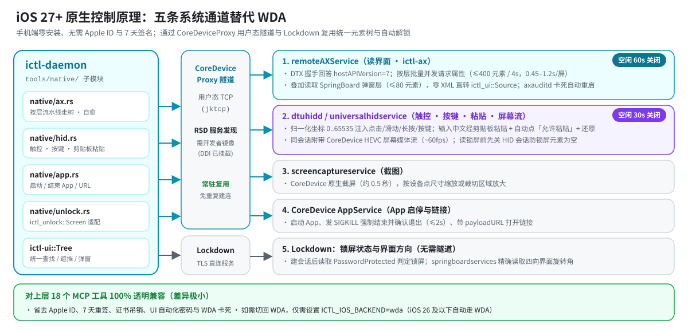

# iOS 27 上不用 WDA（原生控制）

状态：0.2.7 起，iOS 27 及以上的手机默认走原生控制（#123）；设 `ICTL_IOS_BACKEND=wda` 可切回 WDA，iOS 26 及以下照旧使用 WDA。核心代码在 `crates/ictl-ax`、`crates/ictl-device/src/ax.rs` 和 `crates/ictl-daemon/src/tools/native/`（`ax.rs`、`hid.rs`、`app.rs`、`unlock.rs`），整体架构见[架构](../architecture.md)。早期探索背景见 [WDA 依赖调研](wda-dependency-research.md)。

## 1. 技术原理总览

  <picture>
    <source media="(prefers-color-scheme: dark)" srcset="../images/ios27-native-pipeline-dark.svg">
    
  </picture>

为什么可以不装 WDA：

- 主机按 Xcode 方式响应 `remoteAXService` 的 DTX 握手（`hostAPIVersion = 7`）后，无需 WDA 也能读取完整元素树（真机验证于 iPhone 15 Pro Max，iOS 27.2.1；早期调研中「无 WDA 读不到」是因为探针未应答握手）。
- 点击、滑动、长按、按键走 CoreDevice HID（iOS 27 的 `dtuhidd`），截图走 `screencaptureservice`，中文输入走剪贴板粘贴 + 自动点「允许粘贴」（#118、#122），App 启停与链接走 `CoreDevice AppService`。读界面打通后，全部工具链路即完整闭环。

**省掉的运维负担**：Apple ID 登录、免费描述文件 7 天重签、证书被吊销、「UI 自动化」重启后手输密码（`NeedsAutomationPin`）、WDA 启动慢（10～60 秒）及 XCTest 卡死。**仍需的前置条件**：USB 配对、开启开发者模式、挂载开发者镜像（DDI）。

## 2. 范围与边界

- **支持范围**：iOS 27 及以上的 iPhone / iPad，**全部 18 + 6 个 MCP 工具**在不装 WDA 的情况下完整可用，输出格式与 Agent 体验保持一致；随时可通过 `ICTL_IOS_BACKEND=wda` 切回 WDA。
- **不涵盖**：iOS 26 及以下（无 `dtuhidd`，继续走 WDA）；不删除 WDA 代码（低版本及切回 WDA 仍完整维护）。当前控制设备走原生时，自动重签与 Apple ID 会话检查均跳过。

## 3. 各能力实现对照（WDA vs 原生）

| 能力 | WDA 路线（iOS 17–26） | 原生路线（iOS 27+ 默认） |
|---|---|---|
| 截图 | `/screenshot`，约 0.4 秒 | CoreDevice `screencaptureservice`，约 0.5 秒 |
| 读元素（`list_elements`、`then=elements`、按名点击） | `/source` XML | `remoteAXService` 按层流水线走树：类型 4 取前台 App，再按层并发请求类型 5 属性（上限 400 元素 / 4 秒）。直接拼成 `ictl_ui::Source`（零 XML，#211）交给 `ictl_ui::Tree::of`，复用全部查找、遮挡、弹窗与密码栏逻辑 |
| 跨进程元素（小组件、网页） | `ictl_ui::Tree::of` 换算相对坐标 | traits 标出宿主视图并叠加宿主位置；WebKit WebContent 网页元素已为屏幕坐标，原样放置 |
| 系统弹窗、通知横幅、权限请求 | `/alert/text`、SpringBoard 树 | 另读 SpringBoard 应用元素（类型 1，带其 PID）：除状态栏外即为遮盖层，上限 80 元素 / 2 秒 |
| 点击、长按、滑动 | W3C actions | CoreDevice HID（0..65535 归一化坐标）；按名点击使用无障碍提供的点击点 |
| 等界面稳定、界面变化判定 | 轮询 `/source` | 同机制轮询（连续两次树一致且无加载圈）；操作后首次读取前等 **0.3 秒**（`REACT`） |
| 输入文字 | `/wda/keys` | 一律经剪贴板粘贴（HID 按键受硬件键盘输入法影响，拼音模式会打成拼音）；自动点「允许粘贴」，读回输入框核对后立即还原剪贴板 |
| 键盘存在检测 | 查找 `Keyboard` 元素 | 查找 `Keyboard` 元素；键盘键归属 App 时有 8 个以上 `Key` 亦判定键盘可见 |
| Home、电源、音量 | XCTest / IOHID | HID；Home 未回到主屏幕时自动改从屏幕底部上滑 |
| 启动 App、前台 App | `/wda/apps/launch`、`/wda/activeAppInfo` | CoreDevice AppService 启动；前台 App 经 `remoteAXService` 类型 4 查询 |
| 结束 App | `/wda/apps/terminate` | AppService 发 `SIGKILL` 并等待进程真正退出（上限 2 秒） |
| 打开链接 | `/url` | AppService 启动处理该链接的 App 并带 `payloadURL`（同 `devicectl --payload-url`） |
| 锁屏状态 | `/wda/locked` + 树核对 | Lockdown `PasswordProtected`（须先建会话） |
| 自动解锁 | `ictl-unlock` 经 WDA 读密码栏并逐位核对 | 复用同一套 `ictl-unlock`（`tools/native/unlock.rs` 实现 `Screen`）：无障碍读界面、HID 点击；停用标记与逐位核对规则完全一致 |
| 屏幕尺寸、方向 | `/wda/screen`、`/rotation` | 每次读界面记录尺寸；方向问 Lockdown `springboardservices` |
| 控制台实时画面 | WDA 9100 MJPEG → 本机 H.264 / MJPEG | 手机硬件 HEVC 媒体流（`ScreenStream`，~60fps；浏览器不支持 HEVC 时由 ffmpeg 转 H.264） |
| 开发者工具（日志、崩溃、安装、Web Inspector） | 不经 WDA | 完全一致 |

## 4. 架构与模块分工

- **`crates/ictl-ax`**：`remoteAXService` 的 DTX 会话。握手流程：`_notifyOfPublishedCapabilities:` → 等待 `deviceAPIVersion` → `clientNeedsAccessibility: true`；应答 `hostAPIVersion = 7`；对手机要求回执的消息逐条回空回执。自研帧读取（避免上游 `RemoteServerClient` 遇未知消息直接退出）与两层 `NSKeyedArchive` 解码（含环检测与预算上限，仅解所需字段）；`tree::assemble` 按阅读顺序装配，`node::to_node` 直转 `ictl_ui::Source`。
- **会话归属与自愈**：无障碍会话与 HID 会话一样归 `Tunnel` 持有并常驻复用，空闲 60 秒关闭（`AX_IDLE`）；连接断开重建但不重放写操作。若手机端 `axauditd` 偶发卡死导致读屏持续超时，守护进程自动通过 AppService 结束 `axauditd` 后重试（#152）。
- **守护进程路由与子模块**：`ICTL_IOS_BACKEND`（`auto` / `native` / `wda`）决定 iOS 27+ 路线（iOS 26 及以下始终 WDA）；原生工具实现拆分为 `tools/native/{ax,hid,app,unlock}.rs`。
- **状态机与向导**：原生就绪 = 已配对 + 开发者模式 + DDI 完整挂载 + 隧道 + 无障碍首读成功，跳过 `NeedsSigning` / `WdaStarting` / `NeedsAutomationPin`；就绪后持续巡检 DDI 与无障碍活体。`setup` 自动跳过 Apple ID 与 WDA 签名，`status` / `doctor` / 控制台均标明「原生」。

## 5. 对 Agent 可见的细微差别

- **元素粒度更粗**：无障碍服务常把列表一整行合并为单个元素（如「Wi-Fi、Home-WiFi」），输出比 WDA 更精简；按子串查找照常命中。
- **屏幕外的行不列出**：长列表须先滚动（或使用 `iphone_scroll_collect` / `iphone_tap_element` + `scroll`）再点击。
- **粘贴输入**：输入框原本就是同一段文字（如 Spotlight 残留上次搜索词）时，结果会提示截图确认（#133）。

## 6. 风险与对策

| 风险 | 对策 |
|---|---|
| 私有协议与属性编号随 iOS 大版本变化 | 每个 iOS 大版本发布后运行全套真机回归；异常时 `status` 报「准备手机失败」，可设 `ICTL_IOS_BACKEND=wda` 切回 WDA（不静默降级） |
| 推送事件漏发或延迟 | 不依赖推送，每次读界面主动流水线走树并设元素数与时间上限 |
| 长期挂无障碍会话影响手机 | 空闲 60 秒自动关闭会话，仅操作期间保持 |
| 锁屏后 `axauditd` 偶发卡死 | 读屏超时自动终止手机端 `axauditd` 后重试恢复（#152） |
| 自动解锁输错锁屏密码 | 与 WDA 共享 `ictl-unlock` 全局停用标记与逐位核对，绝不二次盲试 |

## 附：真机协议实测笔记（iPhone 15 Pro Max，iOS 27.2.1）

- **推送局限**：手机仅在前台 App 切换或刚连上时主动推送树，App 内跳页不推送；主动请求整棵树（类型 11，无参）会触发手机断连，故固定按层走树。
- **按层流水线加速**：逐个串行请求约 40ms/元素（57 元素需 2.5s）；改按层批量并发发出并凭 `associatedTranslationObject` 配对后，整屏降至 **0.45～1.2 秒**。
- **HID 媒体流遮蔽锁屏无障碍**：HID 屏幕媒体流开启时，锁屏界面在无障碍树中为空。读锁屏前须先关闭 HID 会话（约 0.1～0.7s 后恢复可读），点击时再重开（约 0.5s）；解锁完成后等待 0.7s 避免锁屏滑开动画吞掉首个点击。
- **密码栏与系统弹窗归一化**：锁屏密码栏原始类型为 `TextField`（值「共6位数，已输入0位」），`node::to_node` 归一化为 `SecureTextField`；SpringBoard 权限问询（如「允许粘贴」）不含 `Alert` 节点，符合「前台为 SpringBoard、元素少、≥2 按钮、无图标/键盘/密码栏/单元格」特征时自动包裹为 `Alert`。
- **锁屏状态与解锁耗时**：Lockdown 读取 `PasswordProtected` 须先建立会话（否则报 `this request was prohibited`）；原生 6 位密码自动解锁全程约 **8～10 秒**（关 HID 等锁屏 1.5s + 每位点击核对 ~0.7s）。
