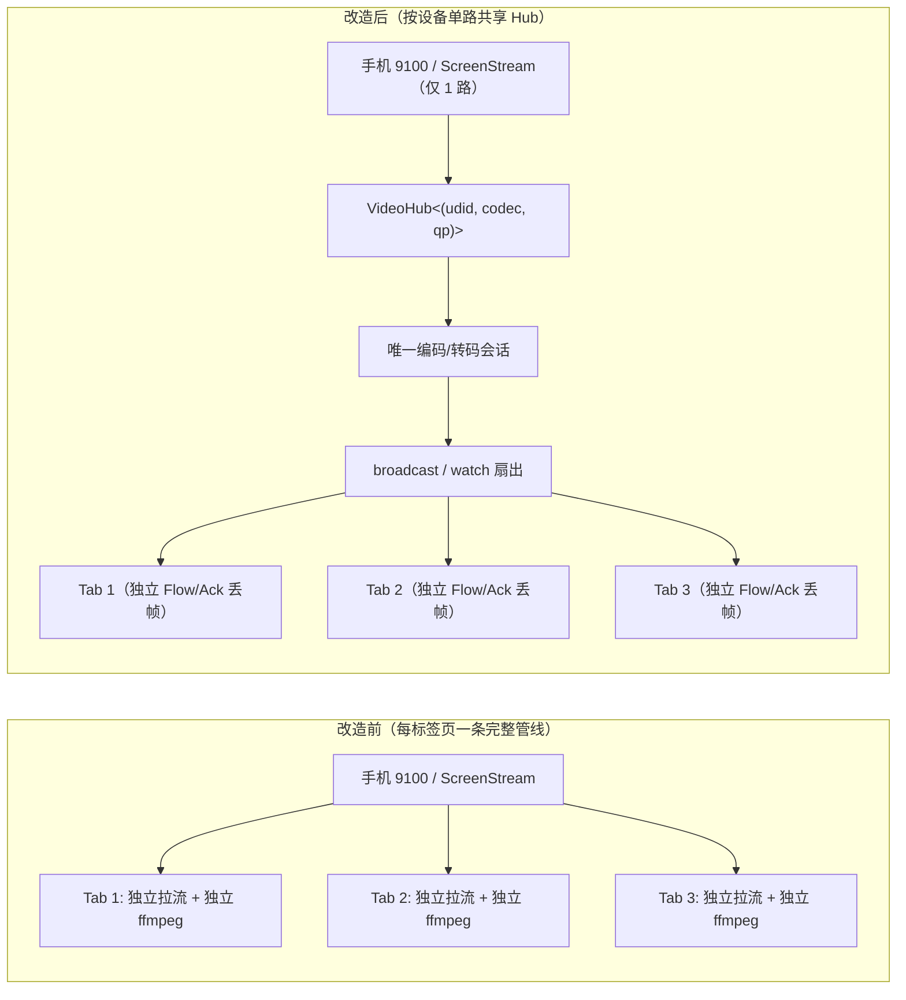

# 项目整体 Review 与优化改造方案（v0.2.14）

> **现状（2026-11-26，main `a8d8796`）**：这份方案已经做完，或被第二轮复审接替。下面「实施记录」写明每一项最后怎么处理；「一」到「七」节是 2026-11-25 写方案时的原文，没有改，只作记录。其中的行号、文件名、数量（比如 `viewer.html` 单文件、538 个单测）都是当时的，现在已经变了。现在的架构以 [architecture.md](../architecture.md) 为准，问题和修法以 [regression-cases.md](regression-cases.md) 为准。

## 实施记录

### 第一轮：按本方案（2026-11-25）

| 方案里的项 | 结果 |
|---|---|
| PR-0A 文档与站点对齐 | #191 |
| PR-0B 高、中优先级隐患 | #187 |
| 方案 1.1 viewer 迁 hyper | 没迁，缺陷在原来的手写服务端上就地修（#189：分块的 `/mcp`、分块流、满了回 503、干净停机） |
| 方案 1.2 视频单路共享 | #188：每台手机只开一路 MJPEG、一个方向采样。H.264 编码器仍是每个页面一个：交给编码器的快慢要跟着各自的链路，共用一个就得等最慢的页面 |
| 方案 1.3 WDA 连接复用 | 放弃：iPad 上 5 轮 23.71 秒对 24.01 秒，没有收益（usbmuxd 建连接只要几毫秒），还测出过超时后重发的问题 |
| 方案 1.4 运维锁与原生解锁 | #190：空闲的 MCP 不再挡住更新；HID 会话关了原生视频不断 |
| 方案 2.1 `ControlBackend` | 没做 trait（两条路线的语义对不齐），改成穷举的 `Route` 枚举收敛分派（#192） |
| 方案 2.2 页面模块化 | #192：`viewer.html` 拆成 `web/` 下的源文件，`build.rs` 拼成一页嵌进程序（产物逐字节相同）；没做 ES 模块（全局状态共享） |
| 方案 2.3 MJPEG 收归守护进程等 | #192：`Request::MjpegStream`，守护进程转发；`LocalSet` 不换（编译器推断不了高阶 `Send`，原因写在 architecture.md）；依赖重复来自 vendor 的上游，没动 |
| 收尾 | #193（任务 id 转义、转码最多 4 路、轮询合并、清掉上一个守护进程留下的「正在被查看」）；52 复审后 #194、#195 |

### 第二轮：iphone-control-52 对 `d6afa15` 的全量复审（2026-11-25 起）

按 P0 → P1 → P2 分批，每批核实、修复、补单测、真机回归，再交 52 复审：

| 批次 | PR | 内容 |
|---|---|---|
| P0-A | #196 | viewer 和 agent 的安全面：请求头校验、登录前不读请求体、agent 加固 |
| P0-B | #197 | 守护进程的并发和取消安全 |
| P0-C | #198 | 底层 crate：ax archive 判环和预算、HID 坐标校验、ictl-sign 的权限和原子写、vt.rs 等 |
| — | #199 | 两个偶发失败的单测（维护锁、被打断的更新） |
| P1-1 | #200 | 请求校验和协议边界 |
| P1-2 | #201 | 任务状态机、事件流、子进程 |
| P1-3 | #202 | 控制台与主机配置：CSP、Origin、证书和令牌的原子写与加锁、envfile、service |
| P1-4 | #203 | 协议解析边界：DTX、Web Inspector、WDA HTTP、FLV、VideoToolbox |
| P1-5 | #204 | 长时漂移：就绪后查开发者镜像和无障碍服务、进程号缓存过期、任务事件不常驻内存、页面视频不误判永久放弃 |
| P1-6 | 本文件所在的 PR | 文档和站点与代码对齐（复审的 D1–D12），这份方案更新后提交（D12） |

还没做的（P2，先评估再决定做不做）：
- 架构：hyper 迁移、继续拆大文件、界面元素的中间表示、Screen trait 解耦、l10n、前端模块化。
- 性能：滑动后复用元素树、`native_paste` 的空转、HEVC 转码按（设备、质量）共享、MjpegHub 按设备加锁、`app_name` 负缓存、首屏预压缩、`LocalSet` 里的同步写盘、ictl-ax 的 XML 渲染。

---

## 原方案（2026-11-25）

- **评审基线**：`main` @ `51927f1`（`v0.2.14`，2026-11-25）
- **代码规模**：Rust 源码约 49,057 行（11 个 workspace crate）+ Web 控制台前端单文件 `viewer.html` 3,689 行；Rust 单元测试 538 个、Viewer JS 测试 10 组、真机回归清单 168 项（`docs/dev/regression-cases.md`）
- **评审范围**：架构设计、功能实现与代码质量、服务稳定性、性能瓶颈、文档与 GitHub Pages 站点一致性，以及分阶段优化改造方案。

---

## 0. 总体评价

项目整体工程质量处于很高水准：

- **核心定位清晰**：单进程守护进程独占设备（D2）、薄客户端 MCP、无 root 用户态隧道、iOS 27+ 原生控制与 iOS 17–26 WDA 双路线并存。
- **防御性工程实践扎实**：生产代码几乎零 `unwrap()` / `panic!()`；明确区分 `Delivery::{NotSent, Sent, Unknown}` 避免写操作误重放；`lane()` / `scope_check()` 穷举所有 `Request` 变体防止漏处理；`PerDevice` 整块重置避免多设备残留状态；`ictl-protocol/src/env.rs` 用单测自动对账代码、配置页与 `packaging/env.example`。
- **可恢复能力强**：具备独立线程 600s Watchdog、WDA XCTest 卡死探测重启、`axauditd` 卡死自动重启、usbmuxd 3 次容错、证书吊销自动自愈、DDI 缓存 3 次失败重建、Ed25519 签名验证与事务化自更新。

**核心矛盾**：项目已从最初的「单机 WDA USB 遥控器」快速演化为「双后端 + 多设备 + 局域网 HTTPS 控制台 + 实时视频编码/转码 + AI 任务编排 + 远程 HTTP MCP + 自更新」的综合平台，部分早期轻量化实现（尤其是手写 HTTP 服务端、单文件前端、直接叠加在 `Daemon` 上的双后端分支、单连接独立视频管线）已经超出原设计承载范围，开始出现明显的**架构膨胀、多用户/多标签页稳定性风险、性能浪费与文档滞后**。

---

## 一、架构设计评审

### 1.1 当前架构亮点（改造中必须保留）

| 设计 | 位置 | 价值 |
|---|---|---|
| 守护进程独占设备 + 薄客户端 MCP（D2） | `crates/ictl-daemon`、`crates/ictl-mcp` | 复用隧道、HID 与 AX 会话，避免短命 MCP 重复建连 |
| 穷举式请求分流与范围检查 | `crates/ictl-daemon/src/core.rs:1382`、`tasks.rs:218` | 编译期防止新增 `Request` 漏掉车道锁或 App 范围限制 |
| `PerDevice` 单设备状态收口 | `crates/ictl-daemon/src/core.rs:431` | 切设备/断连时一次重置，不会遗留旧设备状态 |
| 写操作不可重放语义 | `crates/ictl-wda/src/http.rs:46-50`、`ictl-protocol` | 发送后断连/超时标记为 `Unknown`，不盲目回退 HID 造成双击/重输 |
| 环境变量代码-文档自动对账单测 | `crates/ictl-protocol/src/env.rs:189` | 新增/删除环境变量时 CI 自动拦住文档脱节 |

### 1.2 已显现的 4 个架构腐化迹象

#### 迹象 1：手写 HTTP/1.1 服务端严重超载（最突出）
- **现状**：`apps/iphone-control/src/viewer.rs`（2,180 行）与 `viewer/mcp.rs` 在裸 TCP/TLS 上手写 HTTP/1.1 解析、Keep-Alive `carry` 缓冲、请求体读取、分块、Cookie/Bearer 登录与吊销、CSRF/Origin/Host 检查、SSE 任务事件、二进制视频流和 `rmcp` Streamable HTTP 转发。
- **后果**：代码复杂度与安全/协议边界维护成本急剧上升，且已经直接引发 `/mcp` 拒绝 chunked 请求、SSE 响应剥离 `Transfer-Encoding` 等协议兼容性缺陷（见 2.1）。同时依赖树中因为 `rmcp` 已经引入了 `http` / `http-body-util`，继续手写裸 HTTP 的边际收益已为负。

#### 迹象 2：双后端（WDA vs Native）三路分叉散落 + Future 栈帧膨胀
- **现状**：iOS 27 原生控制没有抽象为统一的内部 `ControlBackend` 策略，而是以 `if self.wda(g).is_none() && self.native(g)` 或 `match self.wda(g) { Some(w) => ..., None if native => ..., None => ... }` 的三路分支散落在：
  - `crates/ictl-daemon/src/core.rs:1030`
  - `crates/ictl-daemon/src/supervise.rs:199, 338`
  - `crates/ictl-daemon/src/tools/mod.rs:70, 166, 299`
  - `crates/ictl-daemon/src/tools/observe.rs:19, 39, 96, 234, 257`
  - `crates/ictl-daemon/src/tools/input.rs:435, 481, 596, 618`
  - `crates/ictl-daemon/src/tools/keys.rs:70`
  - `crates/ictl-daemon/src/tools/launch.rs:48, 74, 86`
- **后果**：新增能力或修改公共策略（锁屏检查、错误语义、状态采样）极易在某条路径遗漏；且单个 `Daemon` 的 async 状态机极其庞大，代码中不得不遍地手动 `Box::pin(...)` 防止线程栈溢出（如 `core.rs:962, 1205`、`tools/mod.rs:177, 211, 216`）。

#### 迹象 3：巨型单文件堆积，可维护性下降
| 文件 | 当前行数 | 问题 |
|---|---:|---|
| `apps/iphone-control/src/viewer.html` | 3,689 | HTML + CSS + JS 全内联单文件，无模块化与类型检查，仅靠 10 个抽取式 `.mjs` 回归脚本 |
| `crates/ictl-mcp/src/lib.rs` | 2,199 | 工具 Schema 定义、参数校验、路由、batch 编排与单测混在一个文件 |
| `apps/iphone-control/src/viewer.rs` | 2,180 | HTTP 传输、鉴权门控、路由、视频分发、API 处理耦合 |
| `crates/ictl-wda/src/client.rs` | 2,124 | 会话管理、手势、输入回读、锁屏判断、卡死检测混在一处 |
| `crates/ictl-daemon/src/core.rs` | 2,050 | 持久化结构、快照、车道分发、锁管理、参数验证全在单文件 |
| `apps/iphone-control/src/main.rs` | 1,567 | CLI 定义、引导流程、`wda-bridge`、HTTP 工具函数混在一起 |

#### 迹象 4：D2 独占边界“漏水” + 依赖多版本重复
- **D2 绕行**：iOS 17–26（WDA）视频路径上，`viewer` 绕过守护进程直接调用 `ictl_device::Device::find(Some(&udid)).connect_port(9100)`（`viewer.rs:697`），违背了「守护进程独占设备」，也阻碍了多标签页共享流与未来 Wi-Fi 控制（参见 `docs/dev/wifi.md` 第 2 节）。
- **依赖重复**：`Cargo.lock` 实测同时编入多套大版本 crate（`reqwest` 0.12 & 0.13、`rand` 0.8 & 0.9 & 0.10、`syn` 1 & 2 & 3、`thiserror` 1 & 2、`sha2` 0.10 & 0.11、`tungstenite` 0.24 & 0.27、`rustls-native-certs` 0.7 & 0.8 等），增加编译耗时与二进制体积。

---

## 二、功能实现与代码质量评审

### 2.1 高优先级缺陷

1. **`/mcp` HTTP 端拒绝 chunked 请求，且 SSE 响应头不符合 HTTP/1.1 规范**
   - **位置**：`apps/iphone-control/src/viewer.rs:630-632`、`apps/iphone-control/src/viewer/mcp.rs:68-74`
   - **现象**：
     - `POST /mcp` 检查 `req.content_length.is_none()` 直接返回 `411 Length Required`，拒绝所有使用 `Transfer-Encoding: chunked` 的 MCP HTTP 客户端或反代改写请求。
     - `mcp::response_head` 显式丢弃 `Transfer-Encoding` 并强写 `Connection: close`，将 SSE 帧裸写进连接仅靠 EOF 定界；经过 nginx / cloudflared / HTTP/2 网关时可能被错误缓冲或无法区分正常结束与提前断连。
2. **原生控制设备上仍定期触发 WDA 重签与 Apple ID 会话检查**
   - **位置**：`crates/ictl-daemon/src/supervise.rs:169-184`
   - **现象**：
     - `next_resign` 条件仅检查 `g.device.is_some() && g.persisted.wda_bundle.is_some()`，未判断 `!self.native(g)`。当多设备混用（或当前 iOS 27 设备曾切回过 WDA）时，`wda_bundle` 是全局持久化字段，会对原生设备继续做描述文件检查和自动重签。
     - `next_session_check` 完全不判断当前设备是否使用 WDA，只要本地曾存过 Apple ID 会话，原生用户每 24 小时仍会联网验证并可能收到“Apple ID 会话失效”告警，与 `docs/dev/ios27-native.md:44` 的设计意图冲突。

### 2.2 中优先级隐患

3. **多处协议/媒体读取缺少总大小上限（潜在 OOM 风险）**
   - `crates/ictl-wda/src/http.rs:132-146`：按响应头 `Content-Length` 直接 `buf.reserve((split + n).saturating_sub(buf.len()))` 且循环无上限扩展。
   - `crates/ictl-ax/src/dtx.rs:64-69`：仅限制单片 `len <= 64 MiB`，未限制多 fragment 累加到 `payload` 的总字节数，且在 `read_exact` 前按包头直接 `vec![0u8; len]` 预分配。
   - `crates/ictl-device/src/media.rs:187-189`：`Assembler::current` 拼接 RTP 负载无帧大小上限，异常丢 marker 时可持续增长。
4. **`HidSession::held_drag` 未记录 `self.contact`，失败/取消时可能遗留按下状态**
   - **位置**：`crates/ictl-device/src/hid.rs:188-205`（对比 `long_press` 第 229 行）
   - **现象**：发送 `TOUCHSCREEN_STATE_CONTACT` 后未设 `self.contact = Some((x1, y1))`，若 `hold` 期间超时或取消，`HidSession::close()` 不会补发 `RELEASE` 释放手指。
5. **`viewer` 无优雅停机处理，且 `MAX_CONNECTIONS = 32` 易在并发观看下打满**
   - **位置**：`apps/iphone-control/src/viewer.rs:292-337`、`apps/iphone-control/src/main.rs:1372`
   - **现象**：主 `accept` 循环不监听 `SIGTERM`/`SIGINT`，停服务或升级暂停时不有序收敛活跃连接和子进程；`MAX_CONNECTIONS = 32` 在“视频流 + SSE + 多条 Keep-Alive API + `/mcp`”组合下每个标签页约占 3~5 连接，多人局域网观看时极易触顶，且超限时静默丢弃连接（无 503，无日志）。
6. **权限与安全边界细节**
   - **macOS 本地 HTTP 客户端 PID 识别缺失**：`apps/iphone-control/src/viewer/peer.rs:49-52` 在非 Linux 平台恒返回 `None`。macOS 上如果 Agent 读取了本机令牌并走 HTTP API 控制任务，无法借 `for_pid` 拦截。
   - **Scoped task 未限制 `TerminateApp`**：`crates/ictl-daemon/src/tasks.rs:241` 对 `TerminateApp` 返回 `None`，限定 App 范围的任务仍可强杀手机上任意非范围内 App。
   - **`viewer/auth.rs` 写入与校验加固**：`viewer/auth.rs:199` 原子写共用固定文件名 `.tmp` 且无锁（并发改令牌有竞争）；`viewer/auth.rs:367-374` `failed()` 两次加锁有微小竞态；`viewer/auth.rs:392` 手写常量时间比对建议替换为已引入的 `ring::constant_time::verify_slices_are_equal`。

### 2.3 低优先级代码瑕疵与冗余

- **`resign_now` 成功后未清旧后台记录且未唤醒巡检**（`crates/ictl-daemon/src/supervise.rs:1024-1028`）：重签完成后未 `self.forget_detached_here(g)` 且未调用 `self.wake.notify_one()`，用户需白等最多 10 秒才拉起新 WDA。
- **`install_app` 重复清空两次缓存**：`crates/ictl-daemon/src/core.rs:1134` 与 `crates/ictl-daemon/src/devtools.rs:210` 在成功安装后各自加锁清空了一次 `dev.apps`。
- **原生模式截图文案失准**：`crates/ictl-daemon/src/tools/mod.rs:367` 在无 WDA 时硬编码 `via = "HID"`，但 iOS 27 原生模式实际走的是 CoreDevice `screencaptureservice`，并不经过 HID。
- **PID 缓存未随终止清理**：`crates/ictl-daemon/src/tools/native.rs:285-314` 中 `g.dev.bundles` 在 `native_terminate` 结束进程后未移除对应 PID（超长运行时存在极低概率 PID 复用脏映射）。
- **前端细微加固**：`viewer.html` 整体 XSS 防护到位（`mdLite` 先整体 `esc()` 再白名单替换），唯 `turnHtml` 中 `t.id` 未包裹 `esc()`（虽为守护进程生成的 12 位 hex，补上更稳妥）。

---

## 三、服务稳定性与运维风险评审

**单机单设备常规使用**：已达较高生产稳定度。
**高发/隐性稳定性风险（共 6 项）**：

1. **原生自动解锁期间反复开关 HID 会话，引发抖动并踢断实时视频流**
   - `crates/ictl-daemon/src/tools/native.rs:1008-1113`：每读一次锁屏密码框先等 `TOUCH_LANDS = 350ms` 再关闭 HID，每点一位数字又重开 HID（~500ms）。6 位密码连续开关 7~8 次：拉长耗时（8~9s）、增加媒体流启停失败面，且会连续踢断所有在线控制台的 `ScreenStream`。
2. **多观看者无视频源共享，易压垮手机 WDA 或宿主机 CPU**
   - `apps/iphone-control/src/viewer.rs:697-727`：WDA 模式下每开一个控制台标签页就会向手机 9100 端口建一条独立 MJPEG 连接并起一套编码器，多标签页可直接把手机 WDA CPU 打超 iOS 80% 限额导致进程被杀；原生 HEVC 下非 Safari/Linux Chrome 每个标签页独立拉起一个 `ffmpeg` HEVC→H.264 转码进程且无并发上限。
3. **多标签页放大守护进程设备锁竞争**
   - `crates/ictl-daemon/src/screen.rs:159-186`：每个 `ScreenStream` 连接各自每秒尝试抢一次设备锁采样屏幕方向（N 个页面 = N 次/秒），叠加页面侧多个独立定时轮询（`/api/info`, `/api/daemon`, `/api/alert`, `/api/agent/tasks`）。
4. **单线程 `LocalSet` 将同步 I/O / CPU 解析与 60fps 视频转发耦合**
   - `crates/ictl-daemon/src/lib.rs:68`：整个守护进程跑在单线程 `LocalSet` 中（历史上因 `plume_core` 非 `Send`，现已全部移入 `spawn_blocking`）。同步文件写（`state.json`、`daemon.log`、`tasks/<id>.jsonl`）和大元素树 XML 解析会直接卡顿同一线程上的 `ScreenStream` 帧转发和 `TaskEvents` 推送。
5. **常驻 MCP 客户端导致自更新长期 Busy**
   - `apps/iphone-control/src/main.rs:328-337` + `update/transaction.rs:192-214`：只要桌面端开着 Claude Desktop / Cursor / Claude Code，其拉起的常驻 `iphone-control mcp` 进程始终持有 `maintenance::shared()` 并命中 `check_clients`，使得 `auto-patch` 无人值守升级在多数桌面场景下几乎永远拿不到排他锁。
6. **上游依赖与 Watchdog 硬退出的残余影响**
   - `Cargo.toml:109` 锁定 `idevice` 开发分支提交 `89702099`；
   - `watchdog.rs:52` 触发 `std::process::exit(1)` 时无法走 `daemon.shutdown()`，若卡死时正开着 HID 媒体流，手机会残留「屏幕正被查看」状态。

---

## 四、性能瓶颈与优化空间

| 优先级 | 热点位置 | 现状开销 | 优化方向与预期收益 |
|---|---|---|---|
| **高** | `apps/iphone-control/src/viewer.rs:697-727`、`video/` | 每个浏览器标签页独立拉流 + 独立编码/转码 | 引入按 `(udid, codec, qp)` 的单路共享 Hub 广播；N 个观看者 CPU/USB 流量从 `O(N)` 降至 `O(1)` |
| **高** | `crates/ictl-device/src/media.rs:180-223` | 即使 `frames.receiver_count() == 0`（Agent 操作期间无观看者），仍以 60fps 拼接整帧、扫描 NAL 并分配 `Arc<Vec<u8>>` | 无订阅者时仅捕获并更新 VPS/SPS/PPS 参数集，跳过 VCL 帧拷贝与分配，显著降低自动化期间 CPU 与分配抖动 |
| **中** | `crates/ictl-wda/src/http.rs:158-169` | 每个 WDA 请求新建 usbmuxd 连接 + `Connection: close` | 复用 Keep-Alive 单连接（按现有 `Content-Length`/chunked 定界，失败即丢弃重连）；`status`(4 请求)、`wait_for`、`settle`、`scroll_collect` 延迟直降 |
| **中** | `crates/ictl-daemon/src/screen.rs:159-186` | 每个观看连接每秒各自采样一次屏幕方向 | 改为守护进程内单个按需方向采样器（仅 `screen_viewers > 0` 时 1 次/秒），多连接共享广播 |
| **中** | `apps/iphone-control/src/video/mod.rs:400-411` | `serve_mjpeg` 每帧 `last = Some(j.clone())` 再 `Arc::new(j)`，多一次整帧 memcpy | 对齐 `serve()` 直接持有 `Arc<Vec<u8>>`，消除每帧冗余拷贝 |
| **低** | `crates/ictl-daemon/src/devtools.rs:344` | `LogFilter::matches` 在遍历 20,000 条日志时每条都重新 `self.grep.to_lowercase()` | 提前在循环外预处理一次小写关键词 |
| **低** | `apps/iphone-control/src/viewer/auth.rs:296-307` | 每次 HTTP 请求与每 5s 吊销检查都在 tokio worker 线程同步 `stat` 令牌文件 | 增加短 TTL（如 1s）检查节流或异步文件监控 |

---

## 五、文档与 GitHub Pages 一致性审计

GitHub Pages（`website/`）中英文 16 个页面结构严密对齐，SVG 架构图与特性图也已同步至 iOS 27 原生控制，但核查出 **12 处需要修正或补齐的不一致**：

| # | 类别 | 文件与行号 | 现状问题 | 目标修正 |
|---|---|---|---|---|
| 1 | **事实错误** | `website/guide/security.md:9`<br>`website/en/guide/security.md:9` | 错写「数据目录里有配对记录」 | 更正为「配对记录由系统 `usbmuxd` 存在 `/var/lib/lockdown`（Linux）或 `/var/db/lockdown`（macOS），不在数据目录」（与 `deploy/backup.md:17`、`SECURITY.md:19` 一致） |
| 2 | **同页矛盾** | `website/guide/getting-started.md:7`<br>`website/en/guide/getting-started.md:7` | 第 7 行仅写「Mac（Apple 芯片）」，与第 52 行「0.2.14 起支持 Intel Mac」冲突 | 第 7 行改为「Mac（Apple Silicon 或 Intel）」 |
| 3 | **参数过时** | `website/troubleshoot/faq.md:22`<br>`website/en/troubleshoot/faq.md:22` | 写「守护进程每 60 秒重试」自动化密码框 | 更正为「守护进程每 5 秒重试一次（每次尝试等待约 25 秒）」，对齐 `machine.rs:59` 与 `supervise.rs:27` |
| 4 | **能力漏更** | `website/guide/tools.md:26`<br>`website/en/guide/tools.md:26` | 写「原生控制下 `replace: true`…」 | 补充 WDA 设备同样支持 `replace: true`，并说明失败回滚差异（对齐 `tools/input.rs:610` 与 `docs/tools.md:26`） |
| 5 | **触发遗漏** | `website/troubleshoot/faq.md:102`<br>`website/en/troubleshoot/faq.md:103`<br>`docs/troubleshooting.md:47` | 灵动岛「配对的电脑」只提了 HID 后备和控制台视频 | 补充 iOS 27 默认原生控制的点击/滑动/按键同样会开启屏幕媒体流（空闲 30 秒关闭） |
| 6 | **安全漏更** | `website/guide/security.md:19`<br>`website/en/guide/security.md:19`<br>`SECURITY.md:16,31,36-39` | 仍只写安装脚本核对 sha256；`SECURITY.md` 未体现手机侧 WDA 回环限制（PR #180）、iOS 27 免 Apple ID/Anisette、scoped tasks | 更新为 Ed25519 签名清单 + sha256 校验；在 `SECURITY.md` 补齐 `USE_IP=127.0.0.1`、原生控制差异及任务范围说明 |
| 7 | **平台差异漏写** | `website/guide/remote.md:95,120`<br>`website/en/guide/remote.md` | 未说明本机 HTTP 控制台请求的进程识别（`viewer/peer.rs`）仅限 Linux | 补充说明：Unix socket 上的 `SO_PEERCRED` 跨平台生效，但经 HTTP 控制台 API 的本机进程识别目前仅在 Linux 生效 |
| 8 | **工具文档脱节** | `docs/tools.md:11,14,77,83` | `iphone_wait_for` 漏了 `state: "disappeared"`；第 77 行错写无 WDA 不能自动解锁；缺原生控制说明 | 补齐 `state` 参数、更新自动解锁说明、补齐原生控制章节并与 `website/en/guide/tools.md` 对齐 |
| 9 | **架构图严重过时** | `docs/architecture.md:5-30,158,161` | ASCII 图漏 `ictl-ax`/`ictl-webinspector`/`ictl-l10n`/`viewer`，仍写 `XCUITestService` 启动 WDA 且无原生路线；`state.json` 漏新字段 | 重绘架构图对齐 `website/public/architecture-light.svg`；更新 `state.json` 字段列表（`detached_wdas`, `loopback_wdas`, `button_ways`, `resign_result`） |
| 10 | **排错文档滞后** | `docs/troubleshooting.md` | 几乎全按 WDA 时代撰写，缺少原生控制排查节 | 同步 `website/en/troubleshoot/faq.md` 的原生控制排查章节 |
| 11 | **内部自相矛盾** | `docs/dev/ios27-native.md:15,44` | 第 15 行说「已装 WDA 照常重签」，第 44 行说「重签与会话检查只对 WDA 设备做」 | 与 Phase 0 的代码修复保持同一口径 |
| 12 | **发布文档小漏** | `docs/dev/release-updates.md`<br>`docs/task-control.md` | 前者漏 `macos-x86_64` 目标；后者残留旧文件名 `viewer-token` | 补齐 `macos-x86_64` 并将旧文件名标注更新为 `viewer-tokens.json` |

---

## 六、分阶段优化与改造实施方案

按 **风险可控、先止血再重构、每步独立可测可合并** 的原则拆分为三个阶段：

### Phase 0（P0：快速止血与文档对齐，预计 2 个 PR）

#### PR-0A：全量文档与 GitHub Pages 站点对齐
- **目标**：一次性消除第五节列出的 12 处文档不一致。
- **改动范围**：
  - `website/guide/{getting-started,security,tools,remote}.md`、`website/troubleshoot/faq.md` 及对应 `website/en/**`
  - `SECURITY.md`、`docs/tools.md`、`docs/architecture.md`、`docs/troubleshooting.md`、`docs/task-control.md`、`docs/dev/{ios27-native,release-updates}.md`
- **验收**：
  - 运行 `pnpm --dir website run docs:build` 确认无死链、构建通过；
  - 运行 `cargo test -p ictl-protocol` 确认环境变量-文档对账测试通过。

#### PR-0B：守护进程与设备层高/中优先级代码隐患快速修复
1. **原生设备跳过不必要的 WDA 重签与 Apple ID 会话检查**（`crates/ictl-daemon/src/supervise.rs:169-184`）
   - 方案：将 `tick()` 中的 `next_resign` 条件收紧为 `g.device.is_some() && !self.native(g) && g.persisted.wda_bundle.is_some()`；`next_session_check` 仅在当前设备走 WDA（或已配置 `wda_bundle` 且存在非原生设备历史记录）时触发；若用户显式运行 `iphone-control resign --force` 则照常允许手动重签。
2. **重签成功后立即清旧后台记录并唤醒巡检**（`crates/ictl-daemon/src/supervise.rs:1024-1028`）
   - 在 `drop_session(g).await` 前调用 `self.forget_detached_here(g)`，结束后调用 `self.wake.notify_one()`，将重签后拉起 WDA 的等待从最多 10 秒降为即时。
3. **协议/媒体缓冲安全上限**
   - `crates/ictl-wda/src/http.rs`：定义 `MAX_WDA_RESPONSE_BYTES = 64 * 1024 * 1024`，校验 `Content-Length` 与实际读入字节数，超限返回 `InvalidData`；
   - `crates/ictl-ax/src/dtx.rs`：定义 `MAX_DTX_MESSAGE_BYTES = 64 * 1024 * 1024`，校验累计 `payload.len() + len <= MAX_DTX_MESSAGE_BYTES`，改用分块读取（如 64 KiB 缓冲循环）替代按头直接预分配大 `Vec`；
   - `crates/ictl-device/src/media.rs`：定义 `MAX_FRAME_BYTES = 8 * 1024 * 1024`，超过时丢弃当前损坏帧并清空 `self.current`。
4. **细节修复打包**
   - `crates/ictl-device/src/hid.rs:196`：`held_drag` 按下时设置 `self.contact = Some((x1, y1))`，结束后清 `None`；
   - `crates/ictl-daemon/src/core.rs:1134`：删除与 `devtools.rs:210` 重复的 `dev.apps.clear()`；
   - `crates/ictl-daemon/src/devtools.rs:344`：`LogFilter` 构造时预存 `grep_lower: String`；
   - `crates/ictl-daemon/src/tools/mod.rs:367`：原生模式下截图来源标为 `"CoreDevice"`（或 `"原生"`），仅 WDA 掉线降级时标 `"HID"`；
   - `crates/ictl-daemon/src/tools/native.rs`：`native_terminate` 结束进程后清理 `g.dev.bundles` 中对应 PID；
   - `apps/iphone-control/src/video/mod.rs:400-411`：`serve_mjpeg` 改为直接复用 `Arc<Vec<u8>>`；
   - `apps/iphone-control/src/viewer/auth.rs`：改用 `ring::constant_time::verify_slices_are_equal`、`failed()` 单锁原子更新、随机后缀临时文件原子写入。
- **验收**：全量 `cargo test` 通过 + 补充单测（DTX 累计超限、WDA 响应超限、原生设备跳过定时会话检查、HEVC 帧超限复位）。

---

### Phase 1（P1：稳定性与性能跃升，预计 3~4 个专项 PR）

#### 方案 1.1：`viewer` HTTP/1.1 服务端迁移至 `hyper`
- **动机**：一次性根治 `/mcp` chunked 411、SSE `Transfer-Encoding` 剥离、手写 Keep-Alive 状态机脆弱、无优雅停机等问题，同时将 `viewer.rs` 从 2,180 行瘦身至清晰的分层结构。
- **架构设计**：
  ```text
  TcpListener::accept
    └─ LAN IP 白名单检查 + 连接配额（长连接池 vs 短连接池分离）
    └─ 首字节嗅探 (TLS 0x16 -> tokio_rustls::TlsAcceptor | 明文 -> Plain)
    └─ hyper::server::conn::http1::Builder::new().keep_alive(true).serve_connection(...)
        └─ Service 层（tower / 手写轻量 Service）：
            1. Host / HTTPS 重定向 / Sec-Fetch-Site 检查
            2. Auth 中间件（Cookie / Bearer / 吊销检测 / 只读 Role 门控）
            3. 路由分发：
               - `/`               -> 静态页面（带 ETag/Cache-Control）
               - `/mcp`            -> 直接透传 `http::Request<Incoming>` 给 `rmcp::HttpService`（原生支持 chunked 请求与 SSE 响应）
               - `/video` `/stream`-> 流式 `http_body_util::StreamBody` 响应
               - `/api/agent/...`  -> SSE `StreamBody` 与任务控制
               - `/api/...`        -> JSON REST API（Origin + JSON 检查）
  ```
- **关键改动**：
  - 增加 `tokio::signal`（`SIGTERM`/`SIGINT`）优雅关闭：停止 accept、通知所有 SSE/视频流退出、终止活跃 Agent 进程组并等待短宽限期；
  - 将连接配额拆分为「长连接（视频 + SSE + `/mcp`）上限 32」+「短 API 请求上限 64」，满载返回标准 `503 Service Unavailable` 并记 warn 日志；
  - 为 `viewer/auth.rs` 令牌文件变更检测增加 1s 内存缓存避免每次请求同步 `stat`；
  - 在 macOS 上评估用 `proc_pidinfo` / `libproc` 补齐 `viewer/peer.rs` 本地端口反查 PID（或在文档保持明确边界）。
- **验证**：`tests/viewer/*.mjs`、现有 `viewer.rs` + `viewer/mcp.rs` 单测、`tests/update_viewer.rs`，新增 chunked `POST /mcp` 与反代 SSE 集成测试。

#### 方案 1.2：视频管线单路共享 Hub（Fan-out）+ 无人观看零组装
- **动机**：消除多标签页场景下的手机 WDA 过载、宿主多路 `ffmpeg` CPU 爆炸、以及无观看者时 60fps HEVC 后台无谓分配。
- **改造前后对比**：



- **实施细则**：
  1. **`ictl-device/src/media.rs` 无订阅者快路径**：在 `receive` 循环收到视频 RTP 包后，若 `frames.receiver_count() == 0`，只解包检查是否包含参数集（NAL type 32/33/34，用于新订阅者首帧补齐），其余 VCL 帧直接跳过 `Assembler` 拼接与 `Arc<Vec<u8>>` 分配。
  2. **`ictl-daemon/src/screen.rs` 方向采样单一定时器**：将 `current_rotation()` 从每个 `screen_stream` 连接中抽离为守护进程内唯一的按需任务（当 `screen_viewers` 从 0→1 时启动，1→0 时停止），通过 `watch::channel<Option<u32>>` 向所有 `screen_stream` 广播方向变化。
  3. **`apps/iphone-control/src/video/hub.rs` 共享扇出层**：
     - 在 `viewer::Ctx` 中维护 `hubs: Mutex<HashMap<HubKey, Weak<VideoHub>>>`，其中 `HubKey = (udid, SourceKind, qp_bucket)`；
     - 第一个订阅者拉起拉流/编码器任务，后续同 Key 订阅者直接订阅其广播通道并请求关键帧；最后一个订阅者断开（`Weak` 失效）自动回收子进程与设备连接；
     - 每个浏览器连接保留各自独立的 `Flow` / `Acks` 拥塞控制，慢连接仅丢弃自己队列中的非关键帧，不拖慢快连接。
- **验证**：多连接并发压测（模拟 5 个并发 `/video` 连接，验证仅启动 1 个 `ffmpeg` / 1 条手机 9100 连接；验证无人订阅时 `media.rs` 零帧分配）。

#### 方案 1.3：WDA HTTP 客户端支持 Keep-Alive 长连接复用
- **位置**：`crates/ictl-wda/src/http.rs`
- **关键约束**：**绝对不能破坏写操作不重放语义**！
- **设计要点**：
  - `DeviceTransport` 内部持有 `tokio::sync::Mutex<Option<Box<dyn ReadWrite>>>` 单连接槽（WDA 本身在守护进程单锁下串行调用，无并发争用）。
  - 请求头改为 `Connection: keep-alive`；读完完整响应后（仅限 `Framing::Length` 和 `Framing::Chunked`，`UntilEof` 丢弃连接）归还连接槽。
  - **幂等 vs 非幂等区分**：
    - `GET`（幂等读，如 `/status`、`/source`、`/wda/activeAppInfo`）：若复用旧连接在**写请求或读响应首字节前**遇到 EOF/BrokenPipe（WDA 空闲回收了连接），透明丢弃旧连接并新建连接重试一次；
    - `POST`/`DELETE`（写操作，如点击、滑动、输入）：在复用连接前检查连接空闲时间（如超过 15s 主动丢弃换新连接）；一旦开始写入后出错，仍严格上报 `WRITE_FAILED` / `AFTER_SENT` 绝不自动重试。
- **验收**：单测覆盖“复用连接成功”“旧连接 EOF 时 GET 透明重连”“POST 写入后失败不重试”，并在 iPad mini 5（WDA 设备）跑 `tests/device/run.py --repeat 5` 对比耗时。

#### 方案 1.4：运维锁与原生解锁体验优化
1. **常驻 `mcp` 与自更新的锁冲突缓解**（`apps/iphone-control/src/main.rs:328-337`、`crates/ictl-mcp`）：
   - **现状根因**：`iphone-control mcp` 在整个进程生命周期一直拿着 `maintenance::shared()`，即使会话完全空闲几小时也在阻断 `update`。
   - **改造思路**：`mcp` 进程启动时不永久持锁，改为**仅在每次 `call_tool` 执行期间**通过守护进程控制接口由守护进程侧统一持有 `maintenance::shared()`（`ictl-daemon/src/lib.rs:163` 本来就已经在每次请求时获取 `maintenance::shared()` 了！）。对于 `update/transaction.rs:192` 的 `check_clients()`，区分“空闲等待 stdio 的 `mcp` 进程”与“正在执行工具/直接访问设备的进程”，允许更新在所有任务和工具调用空闲时执行，升级后守护进程通过 `stopping_marker`（`protocol::connect` 已有重连逻辑）让存量 MCP 客户端在下次工具调用时自动连上新守护进程！
2. **原生自动解锁期间的控制台体验平滑**：
   - `NativeScreen` 解锁开始前在 `PerDevice` 置 `unlocking = true`，向 `ScreenStream` 发送状态提示而非让前端在 8 秒内盲目重连 7 次；解锁完成后一次性恢复视频流（底层仍尊重 iOS 27 锁屏必须关 HID 读元素的硬件约束，但消除前端重连风暴）。

---

### Phase 2（P2：架构演进与技术债清偿，预计 2~3 个 PR）

#### 方案 2.1：抽象 `ControlBackend`，收敛双后端分支与 Future 栈帧
- 在 `crates/ictl-daemon/src/tools/` 下引入清晰的策略枚举或内部 trait（`WdaBackend` / `NativeBackend` / `HidFallbackBackend`），统一由 `Daemon::backend(g)` 决策一次，消除散落在 7 个文件中的三路 `if/match`。
- 将 `crates/ictl-mcp/src/lib.rs` 按职责拆分为 `schema.rs`、`dispatch.rs`、`batch.rs`、`tests.rs`；将 `crates/ictl-wda/src/client.rs` 拆分为 `session.rs`、`actions.rs`、`typing.rs`、`health.rs`。

#### 方案 2.2：`viewer.html` 模块化拆分（保持单二进制分发）
- 将 3,689 行 `viewer.html` 拆分为 `apps/iphone-control/web/` 下的模块化源码（`index.html`、`styles/*.css`、`js/{state,api,video,touch,tasks,markdown,i18n}.js`），通过 `build.rs`（纯 Rust 拼接内联，零 Node 构建依赖）或极简无依赖构建脚本合成单页继续 `include_str!` 进二进制。
- 收益：可直接对前端模块跑标准 Node ESM 单测（替代目前正则截取 HTML 脚本块的测试方式），后续迭代控制台和 Wi-Fi 状态 UI 成本大幅降低。

#### 方案 2.3：WDA MJPEG 收归守护进程 + `LocalSet` 评估 + 依赖治理
- **WDA MJPEG 经守护进程转发**：与 `docs/dev/wifi.md` 第二版（5.4 节 `MjpegStream`）合流，彻底消除 `viewer` 直连 `usbmuxd`，完全回归 D2 独占边界。
- **`LocalSet` 评估**：由于 `plume_core` 已全部在 `spawn_blocking` 执行，检查 `ictl-daemon` 中是否还有非 `Send` 句柄，若无则可移除 `LocalSet`（或至少把 `ScreenStream` 与 `TaskEvents` 连接放到多线程 tokio worker 上，避免同步写盘/XML 解析抖动视频帧）。
- **依赖大版本对齐**：待上游 `idevice` 发布包含 `89702099` 修复的正式版后切回 crates.io 版本，并逐步对齐 `reqwest`/`thiserror`/`sha2` 等重复大版本。

---

## 七、排期路线图与验收矩阵

| 阶段 | PR 拆解 | 预估风险 | 核心验收方式 |
|---|---|---|---|
| **P0** | **PR-0A**：12 处文档与 GitHub Pages 对齐 | 极低 | `pnpm --dir website run docs:build` + `cargo test -p ictl-protocol` |
| **P0** | **PR-0B**：原生跳过重签/会话检查 + 协议内存上限 + `held_drag` + 小瑕疵修复 | 低 | 全量 `cargo test` + 新增边界单测 + 真机验证原生/WDA 启动与重签 |
| **P1** | **PR-1A**：视频 `media.rs` 无订阅零分配 + `screen.rs` 方向采样去重 + `viewer` 视频共享 Hub | 中 | 多标签页并发压测（5 Tab 仅 1 编码器/1 手机流）+ 真机 HEVC & MJPEG 弱网切换回归 |
| **P1** | **PR-1B**：`viewer` HTTP/1.1 迁移 `hyper` + `/mcp` chunked/SSE 规范化 + 优雅停机 | 中 | `tests/viewer/*.mjs` + `tests/update_viewer.rs` + chunked MCP 客户端 & 反向代理 SSE 真机回归 |
| **P1** | **PR-1C**：WDA HTTP Keep-Alive 连接复用 | 中 | 单测（写不重放/读重连）+ iPad WDA 真机 `tests/device/run.py --repeat 5` 耗时对比 |
| **P1** | **PR-1D**：空闲 MCP 不阻断自更新 + 原生解锁视频流平滑 | 中 | `update_viewer.rs` + `update::transaction::tests` + 真机自动解锁联动控制台测试 |
| **P2** | **PR-2A**：`ControlBackend` 抽象与巨型文件拆分 | 中 | 全量单测 + iPhone（原生）与 iPad（WDA）全套 `scenarios.py` 真机回归 |
| **P2** | **PR-2B**：`viewer.html` 模块化拆分 | 低 | `tests/viewer/*.mjs` 全量迁移为 ESM 直接导入测试 + 无头浏览器回归 |
| **P2** | **PR-2C**：WDA MJPEG 经守护进程转发（合流 Wi-Fi 第二版）+ `LocalSet` 与依赖治理 | 中高 | 结合 `docs/dev/wifi.md` §8.3 真机回归 |

> 涉及真机行为变更的 PR（PR-0B、PR-1A~1D、PR-2A、PR-2C）合并前均需按 `CONTRIBUTING.md` 要求在真实设备（iOS 27+ 原生设备与 iOS 17–26 WDA 设备）执行对应 `tests/device/scenarios.py` / `tasks.py` 回归，并同步补充 `docs/dev/regression-cases.md`。
