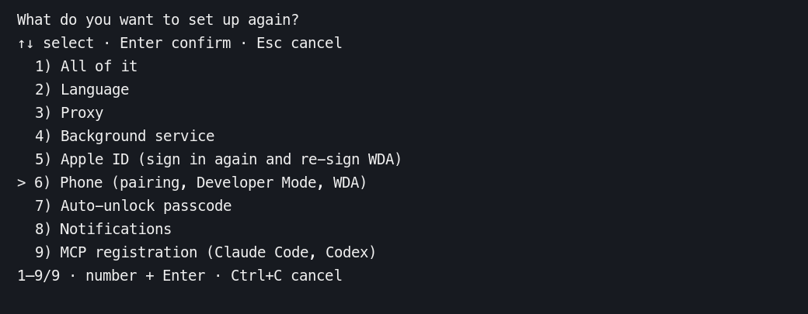

# 终端菜单与 Shell 补全验证

对应个人仓库 Issue #1、#4。离线检查使用临时配置目录。USB 真机验收沿用测试设备已有的配对和 WDA。

## 实现范围

- 设置向导提供方向键/数字菜单、确认与取消、明确选中态、长列表与宽度适配。Esc 取消当前向导；已保存步骤保留，不提供任意步骤回退或全流程事务回滚。
- 文本与密码输入沿用原行为；非交互设置仍拒绝执行，基础终端/重定向菜单回退逐行输入。
- `completions bash|zsh|fish` 从实际 Clap 定义生成，不读设置、不获取维护锁、不连接 daemon。
- Issue #1 的更广泛体验建议（所有长任务进度、完整多面板 TUI、Kaku 外观对照）没有在本次实现中宣称完成。

## 2026-11-13 USB 真机验收

iPhone 14（`iPhone14,7`），iOS 27.0.1，USB 连接 Apple Silicon Mac，macOS 26.6.2。功能分支 `eff3f45` 和上游 `b64b90c` 均以 Rust 1.99.1 构建 release，并运行各自的 daemon、MCP 和默认的 `tests/device/run.py`。每个构建连续运行三次。

| 构建 | 每轮成功调用 | 三轮总耗时（秒） | 中位数（秒） |
| --- | --- | --- | --- |
| 功能分支 `eff3f45` | 14/14 | 16.0 / 15.1 / 15.9 | 15.9 |
| 上游 `b64b90c` | 14/14 | 17.4 / 17.5 / 16.0 | 17.4 |

- 在 `setup --reconfigure` 按 ↓ 到第 6 项，Esc 退出并恢复终端。选择「手机」后依次识别了 USB 设备、已有配对和已开启的开发者模式。此 Mac 没有 CLI 的 Apple ID 登录记录，向导停在第 4 步的邮箱提示。此次沿用已有 WDA，登录、重签和重装未验证。
- 输入 `7` 选择这台手机的自动解锁设置，用 ←/→ 切换「是」「否」，最终确认「否」。向导显示完成并返回 0。
- Bash 3.2、Zsh 5.9 和 Fish 4.9 各验证五种补全，包括 `setup --rec`、`update po`、`completions zs`、`--data-dir check update app` 和上游新增的 `task ru`。
- 默认脚本实测不存在的元素返回未找到、打开系统时钟、选中「秒表」、整屏和局部截图、Spotlight 输入并找到「设置」、回到主屏。测试结束后恢复原有 daemon，并核对进程可执行文件和 WDA 就绪状态。
- Rust 全工作区 357 项通过、3 项标记为忽略。另行运行 PTY 回归，覆盖 Esc 退出码 0、Ctrl+C 退出码 130、退出后恢复终端及输入输出分别使用不同终端时单按 Esc 退出。Clippy、格式检查、21 项 Viewer 测试、17 项安装器测试和双语站点构建通过。

从 USB 验收时的终端记录截取的选中状态。

## 2026-11-13 基于上游 `c4ffe03` 的复测

macOS 26.6.2（Apple Silicon），Rust 1.99.1。

- `cargo test --workspace --all-features --locked` 通过 342 项，3 项标记为忽略。另行运行 `tests/terminal.py` 执行其中的 PTY 菜单用例。
- PTY 验证 Esc 返回 0、Ctrl+C 返回 130，以及 SIGINT、SIGTERM、SIGHUP 退出后恢复 termios。预先写入的 `setup-done` 在取消全量重配后保持原内容。确认框收到间隔 350ms 的「否」仍选择否。空闲用例从首帧末行开始计数。
- Bash 3.2.57 和 Fish 4.9.3 验证实际候选，覆盖前置选项值与子命令同名、嵌套命令、枚举和隐藏的计划任务入口。Zsh 5.9 在 PTY 中用 Tab 验证 `update po`、`completions zs`、`--data-dir check update app` 以及隐藏命令和参数。
- Clippy 全工作区检查、Viewer 的 5 项测试、安装器的 17 项测试和双语站点构建通过。

## 初版 Linux x86_64 验证

以下结果记录于移植到上述上游版本之前。

- `cargo test --workspace --all-features --locked`。
- `cargo clippy --workspace --all-targets --all-features --locked -- -D warnings`。
- `cargo fmt` 对 CONTRIBUTING 指定的所有自有包执行 `--check`。
- `cargo build --release --locked -p iphone-control`。
- `python3 tests/terminal.py --binary <debug或release程序> --test-dir <target/debug/deps>`：方向键、编号与多位编号、确认左右键、Esc/Ctrl+C、termios 恢复、中文长列表、缩放、dumb/小窗口/重定向/管道回退及取消时保留已保存设置、丢弃未保存语言。已接入 Linux/macOS CI。
- 扩展 PTY 回归：默认“是”时输入“否/不”、非法编号 `1x`、无效输入后缩窗、跨提示粘贴、输入长度上限、EOF 截断；CSI/SS3 方向键及中文 UTF-8 以每字节 40ms 分批发送。当前实现仅对 Esc 开头的控制序列使用 250ms 超时，普通 UTF-8 文字跨读保留。
- 补全集成测试：FIFO 设置文件不被读取、未连接模拟 daemon socket、未创建状态目录、帮助中英文、错误参数，以及 Bash/Zsh/Fish 语法。Fish 3.6 通过临时解包的软件包验证实际 `complete -C` 候选、前置全局参数和相似参数值，不做全局安装。
- `pnpm@12.16.1 install --frozen-lockfile` 与 `pnpm run docs:build`，双语站点构建通过。
- `python3 packaging/test_installer.py`：16 项通过。
- `git diff --check`。

## 验证边界

- 本地复测在 macOS 上完成。真实 SSH/tmux/Kaku，以及 Apple ID 登录后的首次签名安装仍待验证。
- 本机 Rust 1.88.0 多次下载未能完成，最终停止了本次下载；尝试 MSRV 检查返回 `missing manifest in toolchain`，未得到有效的编译结果。保留现有 CI 的 1.88.0 检查。
- 未改变打包安装逻辑，补全安装方式为文档中的本地生成；未在本机执行 .deb 安装或 Homebrew 安装。
- 新依赖 clap_complete 4.6.11 声明 MSRV 1.85，MIT OR Apache-2.0 符合现有许可证白名单；console 0.15.11 复用现有锁定版本；termion 4.0.6 使用 MIT 许可证。
