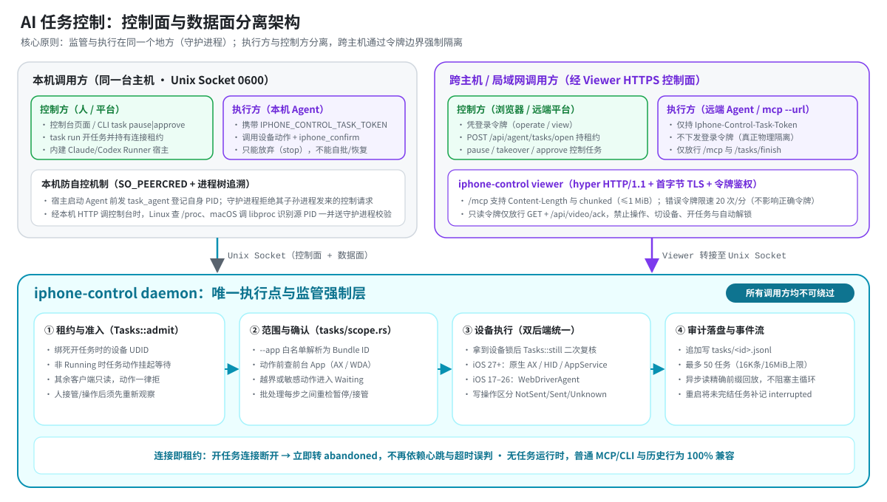
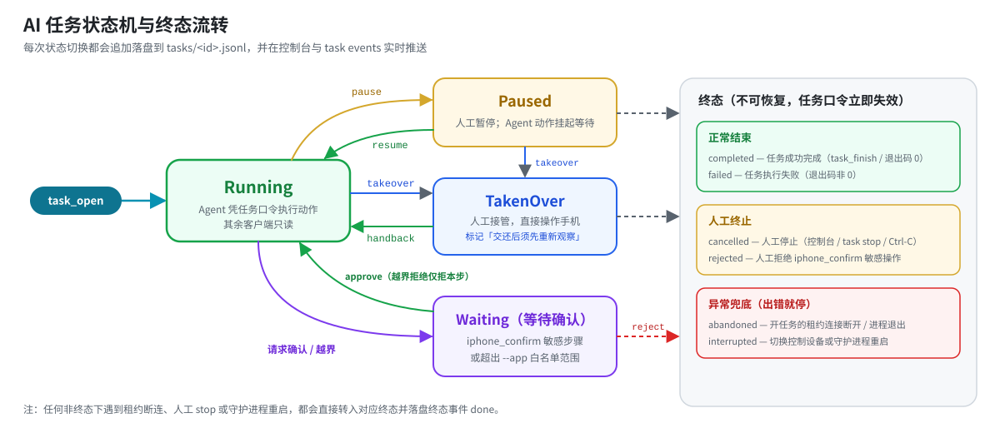

# 任务控制：多个调用方共用一台手机

> **状态**：阶段一至阶段四核心能力均已落地（见[落地进度](#4-落地进度)）；下文记录当前线上架构、协议设计、安全边界与剩余演进项。背景决策见 [D17](decisions.md#d17任务和租约放进守护进程2026-11-12) 与 [#50](https://github.com/Derrors/iphone-control/issues/50)。

## 1. 要解决的问题

一台手机同一时间只能有一个操控者（[D11](decisions.md#d11接多台设备时同一时间只控制一台)），想用它的却很多：控制台里的 AI 任务、外部 Agent 平台、看着页面的人、命令行、定时任务。必须做到：

1. **独占**：同一时刻只有一方在操作手机，由守护进程**强制**执行，不靠各方自觉。
2. **归属**：每个动作都能追到是哪个任务、哪个调用方做的，基于哪次观察。
3. **监管**：暂停、接管、确认、取消在执行点生效，任何客户端都绕不过去。
4. **出错就停**：调用方断开、设备切换、服务重启时，任务立即停止，绝不无人看管继续操作。

## 2. 核心架构

  <picture>
    <source media="(prefers-color-scheme: dark)" srcset="images/task-control-arch-dark.svg">
    
  </picture>

### 2.1 原则：监管和执行在同一个地方

守护进程本来就是唯一持有手机的进程（[D2](decisions.md#d2守护进程独占设备mcp-是薄客户端)），所有动作都在它那里排队拿锁。监管直接放在这里：每个动作经过准入检查（有没有租约、任务处于什么状态、设备对不对、App 范围允不允许）才执行。控制台、命令行、MCP 都是客户端，谁都不能自己决定「现在可以操作」。

### 2.2 核心概念

| 概念 | 含义 |
|---|---|
| 主体（principal） | 调用方：人、外部平台、内建 runner（Claude Code / Codex） |
| 租约（lease） | 谁正在占用哪台设备；接管时转给人，交还时还给任务 |
| 任务（task） | 一件事从开始到结束的全过程，归属某个主体并绑定开任务时的设备 UDID |
| 步骤（step） | 一次动作（提出、准入、执行、结果），归在对应任务名下并落盘 |
| 确认（approval） | 一个待决定的敏感步骤或 App 越界操作，独立编号与审批 |

### 2.3 状态机

  <picture>
    <source media="(prefers-color-scheme: dark)" srcset="images/task-state-machine-dark.svg">
    
  </picture>

每次状态变化都追加写入 `tasks/<id>.jsonl`。守护进程重启后，未完结的任务自动补记为 `interrupted`，不会悄悄消失，审计记录保留。

### 2.4 租约：连接即存活证明

开任务的调用方保持一条连接（本机为 Unix socket，跨主机为 `POST /api/agent/tasks/open` 的 HTTP 事件流），这条连接就是租约。连接断了（进程退出、崩溃、被杀），任务立即转 `abandoned`，之后该任务口令发来的任何动作一律拒绝。不依赖心跳，因此没有心跳超时的误判。

### 2.5 口令与执行/控制分离

- **执行方（actor）**：持有任务口令（`IPHONE_CONTROL_TASK_TOKEN` / `Iphone-Control-Task-Token`），凭它操作手机、报告步骤、请求确认与结束任务。
- **控制方（controller）**：本机通过进程树校验（`SO_PEERCRED` + Linux `/proc` / macOS `libproc`，见 [5.6](#56-执行方不能控制自己的任务25-的落地版)）识别人与宿主；跨主机则持有控制台的 `operate` 登录令牌，实现**物理上的执行/控制分离**（见 [7.6](#76-命名令牌只读权限与跨主机开任务)）。
- **边界说明**：同一系统用户下，进程能读彼此的文件与环境，本机进程校验防的是 Agent 用自己的 Shell 自批/恢复，并非操作系统级隔离；需要严格安全边界时，须将 Agent 放入独立 uid 或沙箱，或跨主机运行。

### 2.6 敏感动作：范围拦截 + 主动确认

仅靠点击坐标无法识别所有敏感操作。通过 **App 白名单（`--app`）**划定任务范围：守护进程在动作前查询前台 App（iOS 27+ 经 `remoteAXService`，iOS 17–26 经 WDA），越界立即挂起等待人工确认；范围内的高风险操作（如在微信中发消息、付款）由 `iphone_confirm` 补充把关。

### 2.7 观察版本与子步骤

- **重新观察（`recheck`）**：人工接管并操作手机、或交还控制后，守护进程标记「需要重新观察」，要求 Agent 先成功截图、读元素或 `wait_for` 一次，才放行下一个动作，避免动作落在旧画面上。
- **子步骤检查**：`iphone_batch` 这类批量请求在**每一步之间**重新检查暂停、接管与任务终态，而非把整批当成不可中断的一步。

### 2.8 设备绑定、统一接口与兼容

- **设备绑定**：开任务时绑定设备 UDID，任务期间禁止切设备；拔线后任务请求因找不到该设备被拒，插回同一台可继续，切到另一台则记为 `interrupted`。
- **统一接口**：控制台内建 Runner、CLI `task run` 与外部平台共用同一套控制面协议（本机 Unix socket，远端经控制台 HTTPS 代理）。
- **向后兼容**：无任务运行时，普通 MCP/CLI 调用与历史行为完全一致；有任务运行时，其他客户端可读屏幕，动作请求被拒并说明占用任务。

## 3. 演进背景（2026-11-12 重构前 vs 现在）

在 `v0.2.2` 之前，AI 任务逻辑全部放在 `viewer` 进程内，通过临时 gate socket 询问是否放行，导致普通 MCP / CLI 可绕过监管、任务不落盘、无租约模型且外部平台无法接入。将任务状态机、连接租约、App 范围校验、JSONL 持久化下沉到 `ictl-daemon` 后，上述 11 项结构性差距已全部在阶段一至阶段四中解决。

## 4. 落地进度

| 阶段 | 内容 | 状态 |
|---|---|---|
| 一 | 任务状态机与连接租约下沉至守护进程：控制面请求、准入、落盘、设备绑定、接管后重观察、批处理子步骤检查；内建 Runner 与 MCP 切到守护进程；`iphone-control task` 命令 | 已完成 |
| 二 | 控制台自动接管运行中的任务（刷新重连、外部创建的任务）；CLI 查看任务事件 | 已完成 |
| 三 | 任务范围（App 白名单）与越界确认（[5.5](#55-任务范围)）；防 Agent 自控（本机 `SO_PEERCRED` + `/proc` + macOS `libproc`，[5.6](#56-执行方不能控制自己的任务25-的落地版)） | 已完成 |
| 四 | 局域网 HTTPS 控制台、控制台独立后台服务（[7.3](#73-https-与同端口分流)）、同端口 Streamable HTTP `/mcp`（[7.4](#74-http-mcp)）、全局令牌登录（[7.5](#75-登录认证与限速)）、命名/只读令牌与跨主机开任务（[7.6](#76-命名令牌只读权限与跨主机开任务)）、远端 stdio 桥接与 `task --url`（[7.7](#77-远端-stdio-转接与-task---url)） | 已完成 |
| 演进 | 更细粒度令牌权限（如「仅允许开任务」）、多设备并发租约 | 按需评估 |

## 5. 守护进程侧详细设计

### 5.1 控制接口请求

均为 Unix socket 上的 JSON 行请求，任务口令通过请求键 `task` 传递（与 `lang`、`expect_udid` 同级）：

| 请求 | 发送方 | 作用 |
|---|---|---|
| `task_open { title, owner, apps? }` | 任务发起方 | 绑定当前设备并创建任务；首行回 `{id, token}`，随后同一连接作为租约持续推送事件，断连即 `abandoned` |
| `task_events { id }` | 任意客户端 | 先回放已有事件，再持续推送新事件，任务结束关闭连接 |
| `task_list` | 任意客户端 | 返回最近任务（含进行中） |
| `task_control { id, action, step?, approve?, for_pid? }` | 人 / 平台 | 执行 `pause`、`resume`、`takeover`、`handback`、`stop`、`confirm` |
| `task_agent` | 宿主进程 | 启动 Agent 前声明自身 PID（`SO_PEERCRED` 核验），使其子孙进程发来的控制请求被拦截 |
| `task_check { token }` | 控制台 | 校验远端 `/mcp` 或 `/tasks/finish` 携带的任务口令是否属于进行中任务 |
| `task_step { tool, args }` | 执行方（带口令） | 声明工具调用开始：非 `Running` 时挂起等待，通过后登记步骤号 |
| `task_step_done { step, ok, ms, text }` | 执行方 | 回报工具调用耗时与结果 |
| `task_confirm { action, detail }` | 执行方 | 挂起等待人工确认 |
| `task_note { text }` | 执行方 / 宿主 | 附加 Agent 说明文本到下一步 |
| `task_finish { ok, summary }` | 执行方 / 宿主 | 结束任务并写入总结 |

### 5.2 两段式准入规则（`Daemon::handle`）

有进行中任务时：

1. **排队前（`Tasks::admit`）**：
   - 带当前任务口令：非 `Running` 则挂起等待（调用方断连立即取消，等完重算排队时间）；固定路由到任务绑定的 UDID，禁止切设备；若标记了「需重新观察」则拒绝非观察类动作。
   - 不带口令：查看类（截图、读元素、状态、列 App）放行；动作类仅在 `TakenOver` 下放行，并置上「需重新观察」（抬起手指始终放行）；切换设备与手动重签一律拒绝。
   - 带已结束或不存在任务的口令：一律拒绝并提示「任务已结束，停下来」。
2. **拿锁后二次核验（`Tasks::still`）**：排队期间人可能刚暂停或交还控制，拿到设备锁后再检查一次；遇暂停/接管/等确认则释放设备锁继续等，用户在交还后的动作则直接拒绝。「需重新观察」仅在一次观察成功完成后清除。

### 5.3 审计落盘与异步回放（`tasks/store.rs`）

每个任务写入 `tasks/<id>.jsonl`，最多保留最近 50 个任务。单任务设事件上限（**16,384 条或 16 MiB**，含首条 `task`）：满额后停写普通事件，但始终放行首条 `task` 与终态 `done`，防止重启误判已完成任务为 `interrupted` 或慢消费者漏收 `done`。事件回放采用「持锁拍下序号与文件字节长度 → 放锁经 `spawn_blocking` 读取精确前缀」，绝不阻塞守护进程主循环。

### 5.4 外部平台命令行（`iphone-control task run`）

`iphone-control task run --title … [--app …] -- <命令>` 创建任务、持有连接租约，并在独立进程组中带着 `IPHONE_CONTROL_TASK_TOKEN` 与 `IPHONE_CONTROL_TASK_ID` 启动命令。命令内拉起的 `iphone-control mcp` 自动加入该任务；命令退出则任务结束（结果取退出码），或由命令内部调用 `task finish [--failed] <总结>` 主动收尾（之后给 5 秒宽限退出）；若任务在别处被停止，则直接终止整个进程组。

### 5.5 任务范围

开任务时可传 `apps`（App 名称或 Bundle ID，`--app` 可重复，控制台通过 Agent 旁的 App 选择器传入），创建时即解析为 Bundle ID，名称无效直接报错拒绝。有范围限制的任务在动作前均经过 `tasks::scope_check`：

| 操作类别 | 检查目标 |
|---|---|
| 启动 App | 目标 App 的 Bundle ID |
| 打开链接 | `http(s)` 视作 Safari；其余自定义 scheme（`tel:`、`sms:` 等）一律询问，同意仅放行本次 |
| 点击、按名点、长按、滑动、输入、触控、网页 JS | 当前前台 App（iOS 27+ 经 `remoteAXService`，iOS 17–26 经 WDA `activeAppInfo`） |
| 安装、卸载 App | 不受白名单豁免，一律先询问 |
| 按键、结束 App、看屏幕 | 不检查（允许被拒后退回允许范围内的 App） |

- 主屏幕（`com.apple.springboard`，含锁屏与通知中心）始终在允许范围内。
- 越界时进入 `Waiting`：同意后该 App 加入本任务白名单；拒绝仅拒该步而不终止任务，让 Agent 退回范围内继续。查不到前台 App 时拒绝盲点。等待确认期间不持设备锁，允许人随时接管。

### 5.6 执行方不能控制自己的任务（2.5 的落地版）

`pause`、`resume`、`takeover`、`handback`、`confirm` 只能由人或控制方执行；仅 `stop` 允许 Agent 自行放弃。守护进程拦截以下两类控制请求：

1. **携带任务口令的控制请求**：Agent 环境自带 `IPHONE_CONTROL_TASK_TOKEN`，在自己环境运行 `iphone-control task …` 即被拒。
2. **来自 Agent 进程树的控制请求**：宿主进程（控制台、`task run`）启动 Agent 前先发 `task_agent` 登记自身 PID（经 `SO_PEERCRED` 校验）。此后任何来自其子孙进程的控制请求均被拒绝（宿主自身发出的放行）。对发往本机控制台 HTTP API 的控制请求，控制台在 Linux 通过 `/proc/net/tcp` + `/proc/*/fd`、在 macOS 通过 `libproc`（`proc_listpids` / `proc_pidfdinfo`，#215）反查源 PID，随 `for_pid` 交由守护进程统一裁决。

所有成功的控制操作均记录 `control` 事件 `{action, by, step?, approve?}`，`by` 标明 `viewer:<令牌名>`（局域网附带 IP）、`cli` 或 `owner`。

## 6. 相比理想目标架构的已知取舍

| 维度 | 当前实现 | 取舍说明 |
|---|---|---|
| 本机口令隔离 | 通过口令 + 进程树（`SO_PEERCRED` / `/proc` / `libproc`）拦住常见自控；跨主机已用登录令牌与任务口令彻底分离 | 同 uid 下并非内核安全边界；需强隔离请分 uid / 沙箱或跨主机运行 |
| 细粒度动作策略 | 强制拦截 App 越界；范围内敏感操作依赖 `iphone_confirm` | 避免误拦正常交互，同时由 App 范围守住外围 |
| 观察版本 | 简化为 `recheck` 标志（人工接管或外部动过手机后置位，成功读屏清零） | 覆盖了最关键的人机交替冲突，无需给每次工具调用增加版本参数 |
| 事件断点续传 | 重连时从精确前缀重放完整文本事件 | 任务事件均为短 JSON 文本，全量重放代价极低 |
| 断线行为 | 拔线时不中断任务（动作因找不到目标设备失败，插回同机可继续）；切到另一台才 `interrupted` | 容忍数据线短暂抖动 |

## 7. 远程控制面与局域网访问

### 7.1 设计目标与演进

`iphone-control viewer` 既是浏览器控制台，也是跨主机 HTTP 控制面与 Streamable HTTP MCP 网关，复用同一端口（默认 `8200`）与同一套认证、安全检查，且可作为独立用户服务运行（`iphone-control service viewer install`，自更新时自动暂停并在升级后拉起）。

> 演进注：2026-11-13 第一版 `--lan` 曾临时以无登录 HTTP 落地并很快在同日补齐 HTTPS（7.3）、全局令牌登录（7.5）与命名/只读令牌（7.6）；v0.3.0（#209）将底层手写 HTTP/1.1 迁移至 `hyper`，统一支持分块传输与严格帧头检查。

### 7.2 局域网网络边界（`viewer --lan`）

- **显式开启**：默认仅监听 `127.0.0.1`；指定 `--lan`（或 `IPHONE_CONTROL_VIEWER_LAN=1`）才监听所有 IPv4 网卡。
- **来源地址白名单**：仅接受回环、私网（`10/8`、`172.16/12`、`192.168/16`）、链路本地（`169.254/16`）与 CGNAT（`100.64/10`，Tailscale）来源连接，公网直连直接断开。
- **反 DNS Rebinding 与 CSRF**：`Host` 仅放行回环名、主机名 / `.local`、启动时本机 IPv4 及 `--lan-host` 白名单；带 Cookie 的写操作强制校验 `Origin` 属于本控制台自身；只读接口检查 `Sec-Fetch-Site`。

### 7.3 HTTPS 与同端口分流

- **按首字节分流**：同一端口窥视连接首字节，`0x16`（TLS ClientHello）走 `tokio-rustls`（握手限时 10 秒），其余走明文 HTTP。本机回环明文照常服务；局域网明文返回 `307` 重定向至 `https://<合法 Host>:<端口><路径>`（不用 308 以免切换 `--tls off` 后被浏览器缓存锁死）。
- **默认策略**：`--tls auto` 在启用 `--lan` 或提供自定义证书时自动开启 HTTPS（使局域网浏览器处于安全上下文，从而启用 WebCodecs HEVC / H.264 画面并加密令牌）；也可设 `--tls on|off`。
- **证书管理**：支持用户自定义 PEM（`--tls-cert` / `--tls-key`，如 `mkcert`、`tailscale cert`），默认自动生成 ECDSA P-256 自签证书（800 天，存 `viewer-tls/`，私钥 `0600`），SAN 覆盖回环、主机名、`.local`、本机 IP 与 `--lan-host`，启动与 `service status` 均打印 SHA-256 指纹供首次核对；本机新增 IP 或剩余不足 30 天时自动轮换（序列号取时间戳防 Firefox 冲突）。

### 7.4 HTTP MCP（`/mcp`）

- **协议与传输**：在控制台同端口提供 Streamable HTTP（基于 `rmcp`），工具集与 stdio `iphone-control mcp` 共享同一个 `McpServer`，无任何功能差异（[D10](decisions.md#d10与-toolkit-工具接口一致)）。底层由 `hyper` 解析请求与分块输出 SSE，POST 支持 `Content-Length` 与 `Transfer-Encoding: chunked`（上限 **1 MiB**，同时携带两者或重复 `Content-Length` 拒绝以防走私）。
- **按请求绑定任务**：HTTP 单进程服务多客户端，因此通过请求头 `Iphone-Control-Task-Token` 按请求绑定任务（`protocol::as_task` / `in_task`），带口令即自动暴露 `iphone_confirm` 并记录步骤。
- **开关**：`--mcp on|off`（`IPHONE_CONTROL_VIEWER_MCP`，默认开启）。

### 7.5 登录认证与限速

- **全量强制认证（含本机）**：所有 HTTP 访问（页面、API、画面、SSE、`/mcp`）都必须认证，本机回环也不例外——因为本机运行 frp / nginx / cloudflared 时，公网访客对控制台而言同样来自 `127.0.0.1`。
- **认证形式**：
  - 浏览器：点击 `viewer token` 生成的一次性跳转链接（`/?token=…` → 303 重定向清除地址栏）或登录页 `POST /login`，签发 `HttpOnly; SameSite=Lax`（HTTPS 加 `Secure`）30 天 Cookie `ictl_viewer_<端口>`，值为令牌的 HMAC-SHA256，不泄露原令牌且轮换后立即失效。
  - 程序 / API：`Authorization: Bearer <令牌>`（`/mcp` 的 401 附带 `WWW-Authenticate: Bearer`）。
  - 所有令牌与 Cookie 均采用常量时间比较。
- **抗暴力破解且防 DoS**：全局错误限速为每分钟 20 次；超限后仅对**错误令牌**返回 `429`，**正确令牌与已登录会话始终放行**，防止恶意刷错锁死正常用户。

### 7.6 命名令牌、只读权限与跨主机开任务

- **命名令牌（`viewer-tokens.json`，0600）**：
  - `owner` 为首个默认可操作令牌，支持 `viewer token add <名字> [--read-only]`、`list`、`show <名字> [--new]`、`remove <名字>`（最后一个可操作令牌禁止删除）。
  - 每次校验前检查文件 `mtime` 热重载：增删与轮换立即生效无需重启，被吊销令牌的活跃流（画面、SSE、`/mcp`、任务租约）5 秒内自动切断。
  - **只读令牌（`view`）**：仅放行 `GET`（不含 `/mcp`）与 `POST /api/video/ack`，其余一律 `403`；读元素/查弹窗时不会触发自动解锁；前端根据 `/api/info` 的 `login.role` 自动隐藏全部操作入口。
- **跨主机开任务与物理隔离**：
  - `POST /api/agent/tasks/open`（需 `operate` 令牌，`{title, owner?, apps?}`）：控制台向守护进程 `task_open`，首条 SSE 事件 `opened` 返回 `{id, token}`，随后转发任务事件（每 15 秒发注释保活防代理掐断）；**该 HTTP 响应流即连接租约**。
  - 平台保留登录令牌用于 `POST /api/agent/tasks/<id>/<动作>`，仅将任务口令下发给远端 Agent；控制台仅对 `/mcp` 与 `POST /api/agent/tasks/finish` 接受 `Iphone-Control-Task-Token`，其余控制接口一律拒绝，实现跨主机下的彻底执行/控制分离。
  - `task run --url <控制台> [--ca <PEM>]` 从 `IPHONE_CONTROL_VIEWER_TOKEN` 读取登录令牌并在启动子命令前将其从环境剥离，仅向命令注入 `IPHONE_CONTROL_TASK_TOKEN`、`IPHONE_CONTROL_TASK_ID`、`IPHONE_CONTROL_URL`、`IPHONE_CONTROL_MCP_URL`（及 `IPHONE_CONTROL_CA`）。

### 7.7 远端 stdio 转接与 `task --url`

- **`iphone-control mcp --url <控制台> [--ca <PEM>]`**：在 JSON-RPC 层将本地 stdio 桥接到远端 `/mcp`（Streamable HTTP），独立管理 `Mcp-Session-Id` 与协议版本；普通请求并发转发，通知与服务端回复有序发送，HTTP 故障转回标准 JSON-RPC 错误避免客户端挂死，stdin 关闭时发送 `DELETE` 清理会话。有 `IPHONE_CONTROL_TASK_TOKEN` 时仅携带任务口令，否则携带 `IPHONE_CONTROL_VIEWER_TOKEN`。
- **`task … --url`**：`--url` 与 `--ca` 作用于所有 `task` 子命令（自动回退读取 `IPHONE_CONTROL_URL` / `IPHONE_CONTROL_CA`），使远程控制与事件订阅体验与本机保持一致。
